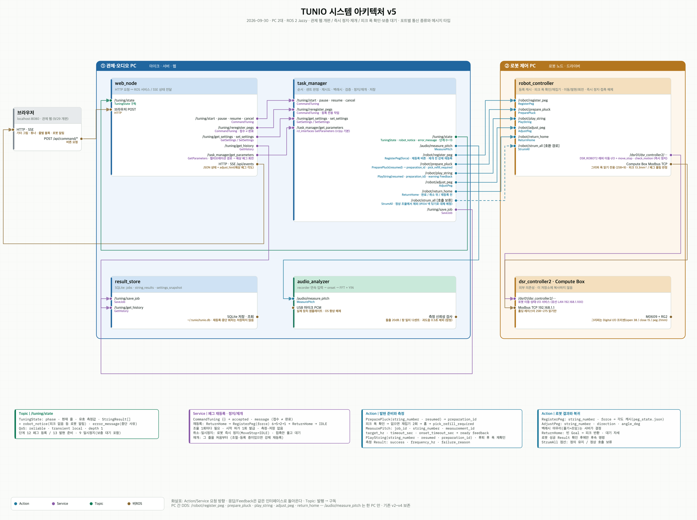
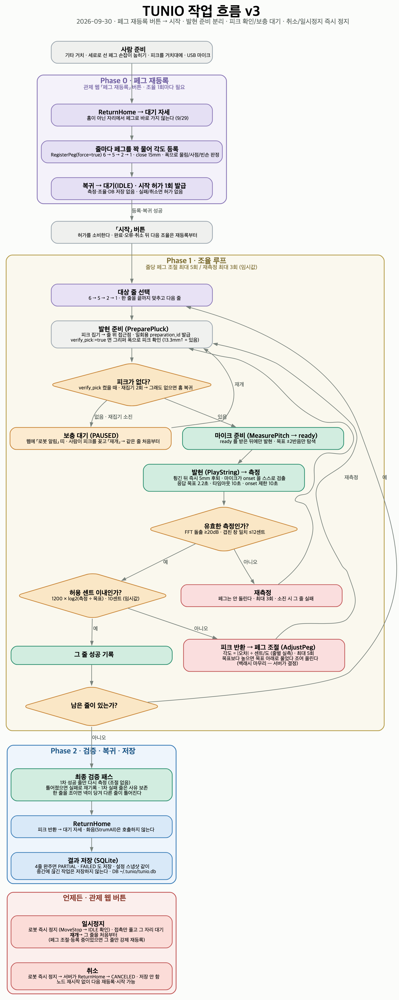

> AI agent로 작업할 경우 먼저 **CLAUDE.md** 를 읽으세요.

# TUNIO — 로봇 기타 자동 조율 시스템

두산 M0609 로봇팔 한 대가 기타 줄을 피크로 튕겨 **마이크로 주파수를 재고**, 페그를 돌려 **자동으로 조율**한다.
카메라(비전)는 쓰지 않는다. 조율 판정은 소리(센트 오차)로만 하고, 힘/토크 센서는 조율 판정에 쓰지 않는다.

*2026-09-30 · main `c6ec065` 기준. 이전 판은 git 이력에 있다.*

---

## 1. 시스템 설계

### 구성 — PC 2대, 노드 5개



[확대 SVG](docs/TUNIO_시스템아키텍처_v5.svg) · [설명](docs/TUNIO_시스템아키텍처_v5.md) · [생성기](docs/TUNIO_시스템아키텍처_v5.py)

- **관제·오디오 PC** (정정인) — `tunio_server` + `tunio_audio`
  - `web_node` — 관제 웹. 브라우저의 버튼을 ROS 서비스로 보내고, 상태를 SSE로 흘려 준다 (`http://localhost:8080`)
  - `task_manager` — 조율 순서 · 센트 판정 · 재시도 · 백래시 마무리 · 검증 · 즉시 정지/재개 · 저장 요청. 설정 서비스도 여기가 낸다
  - `audio_analyzer` — USB 마이크로 onset을 잡고 FFT + YIN으로 주파수를 잰다
  - `result_store` — SQLite (`~/.tunio/tunio.db`) 저장·조회
- **로봇 제어 PC** (정묵·성현) — `tunio_robot`
  - `robot_controller` — 페그 등록 캐시 · 피크 집기/반환 · 발현 · 페그 회전 · 복귀 · 즉시 정지와 접촉 해제. 두산 드라이버(`dsr_controller2`)와 OnRobot Compute Box는 **외부 의존성**이라 이 저장소에 없다
- 두 PC는 같은 Wi-Fi에서 ROS 2(DDS)로 통신한다. PC 사이를 건너는 인터페이스는 로봇 Action 5개뿐이고, 마이크 측정은 한 PC 안이다.

### 패키지

- `tunio_interfaces` — msg · srv · action 정의 (전원. **먼저 합의·고정**)
- `tunio_server` — task_manager · web_node · result_store (정동휘 / 웹·연동 정정인)
- `tunio_audio` — audio_analyzer · recorder · pitch (정정인)
- `tunio_robot` — robot_controller · motion_primitives · teach_points.yaml (정묵·성현)
- `tunio_bringup` — 런치 모음 (station / real_all / sim_*)

### 인터페이스 (tunio_interfaces, 16개)

기준본은 [docs/TUNIO_INTERFACE_SPEC.md](docs/TUNIO_INTERFACE_SPEC.md). 코드와 다르면 문서가 기준이다.

- **Action 7** — `MeasurePitch`(마이크) · `PreparePluck` · `PlayString` · `AdjustPeg` · `RegisterPeg` · `ReturnHome` · `StrumAll`(정의만, 정상 흐름에서 호출 안 함)
- **Service 5** — `CommandTuning`(`/tuning/start · pause · resume · cancel · reregister_pegs` 공유) · `GetSettings` · `SetSettings` · `GetHistory` · `SaveJob`
- **Msg 4** — `TuningState`(`/tuning/state`, transient local) · `StringResult` · `TuningSettings` · `JobSummary`

```bash
ros2 interface list | grep tunio_interfaces
ros2 interface show tunio_interfaces/action/PlayString
```

열거 상수는 **뒤에 추가만** 한다. 번호를 바꾸면 노드 간 불일치가 감지되지 않고 DB 기록까지 재해석된다.

### 작업 흐름



[확대 SVG](docs/TUNIO_작업흐름_v3.svg) · [소스 (graphviz)](docs/TUNIO_작업흐름_v3.dot)

- **Phase 0 · 페그 재등록** — 관제 웹의 「페그 재등록」 버튼. 로봇이 대기 자세로 간 뒤 줄마다 페그를 꽉 물어 손잡이 각도를 기록하고 복귀한다. **조율 한 번마다 필요**하다(허가 1회).
- **Phase 1 · 조율 루프** — 줄별 반복 6 → 5 → 2 → 1. 발현 준비(피크 집기·접근점) → 마이크 ready → 발현 → 측정 → 센트 판정 → 벗어나면 피크 반환·페그 조절 후 재측정(줄당 최대 5회). 음이 높으면 목표 아래로 풀었다 조여 올린다(백래시). 측정이 무효면 재측정(최대 3회).
- **Phase 2** — 1차 성공 줄만 최종 검증(조절 없이 측정) → `ReturnHome`(피크 반환·대기 자세) → SQLite 저장.
- **언제든** — 일시정지·취소 모두 로봇을 **즉시** 세운다(MoveStop → IDLE 확인). 재개는 그 줄을 처음부터. 취소는 서버가 복귀시키고 저장하지 않는다. 노드 재시작 없이 다음 재등록·시작이 된다.
- **피크 확인** (`verify_pick:=true` 로 켤 때) — 집은 뒤와 튕긴 뒤 그리퍼 폭으로 피크 유무를 본다. 없으면 재집기 2회, 그래도 없으면 홈으로 가서 웹에 「로봇 알림」 띠를 띄우고 사람이 피크를 채운 뒤 「재개」를 누를 때까지 기다린다.

핵심 판단 근거는 `CLAUDE.md` 3~5절 — 조율 피드백은 힘이 아니라 마이크로, 최종 접근은 항상 조이는 방향으로, 탐색 범위는 목표 ±2반음.

---

## 2. 환경

- **OS** Ubuntu 24.04 (두 PC 모두)
- **ROS 2** Jazzy · Python 3.12 · rclpy (C++ 없음)
- **DDS** Fast DDS. 강의실 Wi-Fi가 멀티캐스트를 막으면 Discovery Server를 **관제 PC**에서 띄운다
- **네트워크** 두 PC 같은 Wi-Fi + `ROS_DOMAIN_ID` 동일. 로봇 컨트롤러는 로봇 PC와 유선 LAN(`192.168.1.100`), Compute Box는 `192.168.1.1`

## 3. 장비

- **로봇** 두산 M0609 (6축) — TCP는 `GripperDA_v1`(툴 Z 208mm) 하나로 통일. 코드가 켤 때마다 `set_tool/set_tcp` 후 `get_*`으로 확인한다
- **그리퍼** OnRobot RG2 + Compute Box — 제어는 디지털 I/O 프리셋(open 38 / close 15 / peg 21mm, 40N), 상태는 Modbus TCP로 **폭만 읽는다**. 손가락에 고무 골무
- **기타** 스틸 줄 통기타(라이트 게이지 12–53, 스케일 645mm). 대상 줄 6·5·2·1번 (E2 82.41 / A2 110.00 / B3 246.94 / E4 329.63 Hz, A4=440)
- **받침대** 눕힌 기타를 지지하고 헤드(페그)를 띄운다. **세로로 선 페그 손잡이는 사람이 미리 눕혀 둔다**
- **피크 + 거치대** 로봇이 거치대에서 집었다 반환한다. 위치·파지 폭은 `teach_points.yaml`의 교시값
- **마이크** USB 외장 마이크 (OS의 노이즈 제거·자동 음량·에코 제거는 끈다)
- **PC 2대** 관제·오디오 PC(노트북) / 로봇 제어 PC

## 4. 의존성

- ROS 2 Jazzy 기본 패키지 — `rclpy` `std_msgs` `sensor_msgs` `action_msgs` `builtin_interfaces` `rcl_interfaces` `rosidl_default_*` `ament_flake8` `ament_lint_*`
- Python — `numpy` `PyYAML` `sounddevice`(마이크, pip) · 표준 `sqlite3` `http.server`
- **외부 로봇 드라이버 (로봇 PC에만, 저장소에 복사하지 않는다)**
  - 두산 `doosan-robot2` — `dsr_msgs2` `dsr_controller2` `DSR_ROBOT2` 래퍼, `m0609_rg2_bringup` (`~/ws_cobot_pjt/ws_dsr`)
  - OnRobot `onrobot_rg_msgs` / `onrobot_rg_control`
- 개발용 — `pytest` · 도식 재생성에 graphviz(`dot`)·`rsvg-convert` (없으면 `docs/*.py`·`.dot` 머리말의 대체 방법)

## 5. 빌드

```bash
cd ~/tunio_ws
source /opt/ros/jazzy/setup.bash
colcon build --packages-select tunio_interfaces && source install/setup.bash   # 인터페이스 먼저
colcon build && source install/setup.bash
```

인터페이스(msg/srv/action)가 바뀐 커밋을 받았으면 **두 PC 모두** 다시 빌드한다. 한쪽만 하면 통신이 안 된다.
브랜치를 바꾼 뒤 `tunio_interfaces` 빌드가 이유 없이 실패하면 `rm -rf build/tunio_interfaces install/tunio_interfaces` 후 다시.

## 6. 사용법

### 띄우기

```bash
# 두 PC 모두, 터미널마다
export ROS_DOMAIN_ID=10

# 로봇 제어 PC · 터미널 1 — 두산 브링업
source ~/ws_cobot_pjt/ws_dsr/install/setup.bash
ros2 launch m0609_rg2_bringup bringup.launch.py mode:=real host:=192.168.1.100

# 로봇 제어 PC · 터미널 2 — 우리 로봇 노드
source ~/tunio_ws/install/setup.bash
ros2 launch tunio_robot robot.launch.py dry_run:=false verify_pick:=true

# 관제·오디오 PC — 서버 + 웹 + 마이크 (브라우저가 자동으로 열린다)
source ~/tunio_ws/install/setup.bash
ros2 launch tunio_bringup station.launch.py device:=<마이크 번호>
```

- `dry_run` 기본값이 **true**(로봇이 안 움직인다). 실기는 반드시 `dry_run:=false`.
- `verify_pick` 기본값은 **false**. 피크 폭 확인·재집기·보충 대기를 쓰려면 `verify_pick:=true`.
- 서로 안 보이면: 관제 PC `fastdds discovery -i 0 -l 0.0.0.0 -p 11811`, 관제 PC `export ROS_DISCOVERY_SERVER=127.0.0.1:11811`, 로봇 PC `export ROS_DISCOVERY_SERVER=<관제 PC IP>:11811`. `ros2` 명령이 아무것도 못 찾으면 `export ROS_SUPER_CLIENT=TRUE`.
- 런치 인자 — station: `device` `port`(8080) `open_browser` `db` · robot: `dry_run` `speed_scale`(0이면 yaml) `peg_register_force` `verify_pick` `cancel_stop_timeout_sec`.

### 관제 웹에서

1. 오른쪽 위 **연결됨** 확인
2. **페그 재등록** → 네 줄 등록 후 대기 자세로 복귀 → "시작을 눌러 조율하세요"
3. **시작** → 기타 그림의 줄·페그 색과 튜너 게이지, 줄별 블록이 진행을 보여 준다. 튜너 아래 **예상 페그 회전**은 지금 오차로 로봇이 돌릴 각도
4. 끝나면 전체 판정. **작업 이력** 탭에 줄별 결과와 그때 설정이 남는다
5. **일시정지 / 재개 / 취소**는 언제든. 취소한 작업은 저장되지 않는다. 다음 조율은 다시 **페그 재등록**부터
6. **설정** 탭 — 허용 센트(10) · 최대 조절 5회 · 재측정 3회 · 측정 제한 10초 · onset 제한 10초. 작업 중에는 잠긴다. 목표 주파수는 바꾸지 않는다

호박색 **로봇 알림** 띠(피크 없음 등)가 뜨면 피크를 거치대에 꽂고 **재개**.

### 로봇·마이크 없이

```bash
ros2 launch tunio_bringup sim_all.launch.py speed:=fast      # 가짜 로봇·마이크 — 화면과 서버 흐름
ros2 launch tunio_bringup sim_robot.launch.py device:=2      # 마이크만 진짜 — 사람이 줄을 튕긴다
ros2 launch tunio_bringup real_all.launch.py dry_run:=false gripper:=rg2 device:=2   # 한 PC에 전부
```

`sim_*`는 `config/peg_calibration.sim.yaml`(지어낸 값)을 쓴다. 수렴해도 조율 성능의 근거가 아니다.

## 7. 테스트

```bash
source install/setup.bash
ROS_DOMAIN_ID=117 colcon test --packages-select tunio_robot tunio_server tunio_audio
colcon test-result --all
```

2026-09-29 기준 로봇 601 · 서버 153 · 오디오 28. `tunio_bringup`이 빨갛게 뜨는 건 `test/`가 없어서다 (`CLAUDE.md` 10절).
로봇 테스트는 두산 라이브러리(`DR_common2`)가 있어야 전부 돈다.

## 8. 문서

- **기준본** — [인터페이스 명세](docs/TUNIO_INTERFACE_SPEC.md) · [아키텍처 v5](docs/TUNIO_시스템아키텍처_v5.md) · [작업 흐름 v3](docs/TUNIO_작업흐름_v3.dot) · [CLAUDE.md](CLAUDE.md)(결정과 근거)
- **운용** — [관제 웹 구현](docs/TUNIO_관제웹_구현.md) · [피크 확인 동작](docs/피크_확인_동작.md) · [페그 실측표](docs/페그_실측표.md) · [주파수 분석 테스트 가이드](docs/주파수분석_테스트가이드.md)
- **기획** — [기획서 v1.2](docs/기획서_풀버전_v1.2.md) (원안. 이후 결정은 CLAUDE.md)
- **도구** — `tools/` 38개 (페그 실측 `peg_cal.py`, 그리퍼 폭 `grip_cycle.py`, 한 줄 조율 `tune_one_string.py` 등). 목록은 `CLAUDE.md` 12절

## 9. 상태와 범위 (2026-09-30)

- 실기에서 확인된 것 — 페그 재등록, 6·5·2·1번 조율 완주, 로봇 발현 측정(돌출 40dB대), 취소·일시정지·재개, 피크 없음 → 재집기 → 보충 대기 → 웹 재개
- 범위 밖 — 기타 이송(사람이 놓는다), 브릿지핀 안착 확인, 화음(`StrumAll`, #104 넥 닦기로 대체 검토 중)
- **임시값이 많다** — 허용 센트, 재시도 한도, 속도 배율(`speed_scale` 6.0)과 손끝 상한, 정지 확인 시간, 피크 폭 문턱(조건당 2회 표본). 목록은 `CLAUDE.md` 13절
