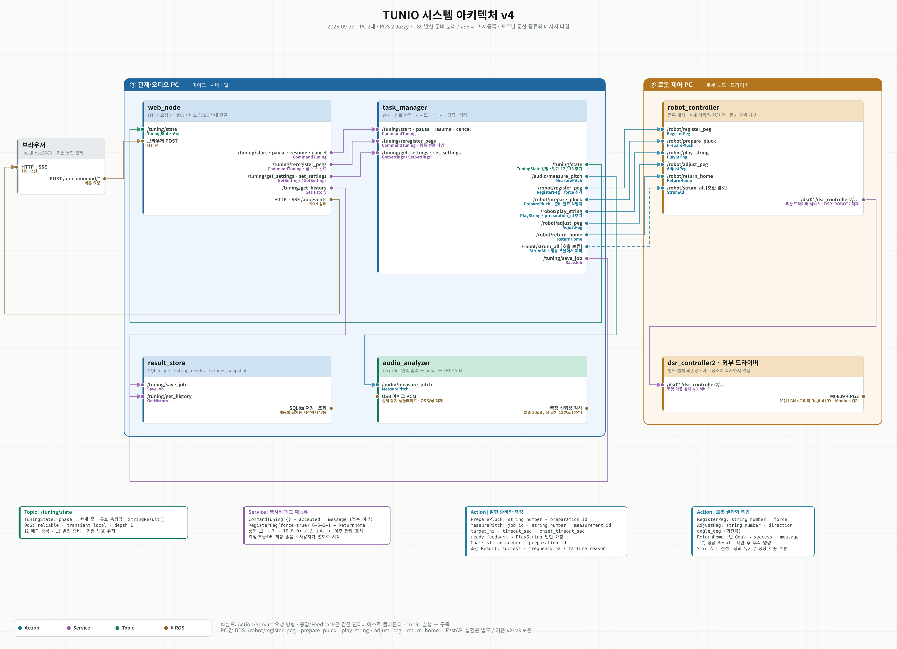

# TUNIO 시스템 아키텍처 v4

> **역사 기록 (2026-09-23).** 현재 구성은 [TUNIO_시스템아키텍처_v5.md](TUNIO_시스템아키텍처_v5.md)를 본다.
> 이 문서의 "미병합" 표시, 시작 시 RegisterPeg(force=false), PlayString 필드, 일시정지·취소 정책은 그 뒤 바뀌었다.

2026-09-23. v3의 2 PC 구성을 유지하고 현재 인터페이스·웹 재등록 흐름을 반영한다.
기준은 main `7be7f8f` + PR #98 `b4dac49` + `feat/web-peg-reregister`의 웹 변경이다.
#98은 main에 병합됐다(병합 커밋 `9ab4e3f`). 웹 후속 변경은 `feat/web-peg-reregister`의 로컬 작업이며 아직 미병합이다.
**이 PR은 문서만 추가한다. 재등록 웹 버튼·HTTP 경로를 사용하려면 별도 웹 구현을 적용해야 한다.** 도식은 그 웹 연결까지 포함한 구성이며, main에 버튼이 이미 배포됐다는 뜻은 아니다.
인터페이스 충돌 시 [TUNIO_INTERFACE_SPEC.md](TUNIO_INTERFACE_SPEC.md)가 기준이다.
기존 v1~v3 파일은 보존한다. v4 도식은 v3 생성기의 노드 카드·포트·직각 배선·범례 형식을 계승한다.
Action(청록), Service(보라), Topic(초록), 비ROS(갈색)를 구분하고 포트마다 인터페이스 이름과 메시지 타입을 표기한다.
노드의 입력 포트는 왼쪽, 출력 포트는 오른쪽에 배치한다. StrumAll의 보류 경로는 점선이다.



[확대 가능한 SVG](TUNIO_시스템아키텍처_v4.svg) · [생성기](TUNIO_시스템아키텍처_v4.py)

## v3 이후 변경

- PC는 여전히 2대다. 관제·마이크 PC의 web_node, task_manager, audio_analyzer, result_store와 로봇 PC의 robot_controller 구성을 유지한다.
- RegisterPeg Action으로 페그 등록과 회전을 분리했다. 일반 시작은 force=false로 유효한 저장값을 재사용한다.
- #98에서 RegisterPeg.Goal.force와 `/tuning/reregister_pegs` 서비스가 추가됐다. 강제 재등록은 별도의 등록·복귀 작업이다.
- #89에서 PreparePluck을 추가했다. PlayString.Goal에는 준비 식별자 preparation_id가 추가됐다.
- ReturnHome은 피크 반환·복귀 전용 Action이다. 정상 조율의 StrumAll 호출은 현재 보류다.
- TuningState 단계 12=페그 등록, 13=발현 준비가 추가됐다. 기존 번호를 바꾸지 않았다.
- 검증은 1차 성공 줄만 수행하며, 실패 줄의 기존 사유를 보존한다.
- FastAPI 실험은 `/home/rokey/tunio_api`의 별도 앱이다. station 런치나 이번 웹 변경에 포함되지 않는다.

## 노드와 책임

- web_node: HTTP 명령을 ROS 서비스로 전달하고 TuningState를 SSE로 전송한다. 시작·일시정지·재개·취소·재등록, 설정, 이력 조회를 제공한다.
- task_manager: 조율/재등록 실행 잠금, 순서, 재시도, 검증, 상태 발행, 결과 저장 요청을 소유한다.
- audio_analyzer: 실제 USB 마이크로 onset과 유효 주파수를 분석한다. recorder는 연속 샘플을 보존하고 pitch는 FFT/YIN·돌출도·창 일치를 검사한다.
- result_store: save_job/get_history를 제공하고 SQLite에 작업·줄별 결과·당시 설정을 저장한다. web_node 이력 조회도 이 노드로 간다.
- robot_controller: 등록·피크 집기 판단·이동·발현·페그 회전·복귀와 등록 캐시를 소유한다. 드라이버는 외부 의존성이며 저장소에 복사하지 않는다.

## 통신 계약

### 웹과 서버

- POST `/api/command/reregister_pegs` → `/tuning/reregister_pegs`, CommandTuning `{}`.
- 기존 POST `/api/command/start|pause|resume|cancel`도 CommandTuning을 사용한다.
- GET `/api/events`는 SSE. 웹은 명령 전 상태 스트림을 연결한다.
- `/tuning/state`: TuningState, reliable / transient local / depth 1. 화면에는 stamp, job_id, phase, 현재 줄, 유효성 플래그와 측정값, 줄별 결과가 전달된다.
- accepted는 접수 여부다. 등록 완료나 물리 정지를 뜻하지 않는다.

### 서버와 로봇

- RegisterPeg: string_number, force → success, message.
- PreparePluck: string_number → success, message, preparation_id.
- PlayString: string_number, preparation_id → success, message. 준비 식별자는 같은 줄에 일회성으로 사용한다.
- AdjustPeg: string_number, direction, angle_deg → success, message.
- ReturnHome: 빈 Goal → success, message.
- StrumAll 정의는 유지하되 정상 조율에서는 호출하지 않는다.

### 서버와 오디오

- MeasurePitch Goal: job_id, string_number, measurement_id, target_hz, timeout_sec, onset_timeout_sec.
- Feedback: ready. Result: 식별자 세 개, success, frequency_hz, failure_reason.
- 로봇 준비 완료 후에만 마이크를 요청한다. 오디오 ready 뒤에만 발현한다.
- onset 제한과 onset 이후 분석 제한은 별개다. 준비를 분리했다고 분석 실패 재시도를 없앤 것은 아니다.

## 두 작업 흐름

### 일반 조율

시작 → 네 줄 RegisterPeg(force=false) → 줄별 [PreparePluck → MeasurePitch ready → PlayString → 분석 → 필요 시 AdjustPeg 후 반복] → 1차 성공 줄 검증 → ReturnHome 성공 → 완료·저장.

### 명시적 페그 재등록

페그 재등록 버튼 → CommandTuning 접수 → PHASE_REGISTER_PEG(12) → 현재 STRING_ORDER 순서로 RegisterPeg(force=true) → PHASE_RETURN(7) → 복귀 성공 → IDLE(0), 빈 job_id.

로봇은 요청받은 줄의 이전 등록을 메모리와 파일에서 무효화하고 새로 등록한다.
실패한 줄의 이전 값을 복원하지 않으며 아직 요청하지 않은 줄의 저장값은 유지한다.
발현·마이크 측정·조율·DB 저장은 하지 않는다. 재등록 후 조율은 사용자가 별도로 시작한다.
dry_run에서는 실제 등록 파일을 갱신하지 않는다.

## 웹에서 완료를 판단하는 방법

- 클릭 즉시 중복 명령을 막고 접수 대기 중 도착한 상태도 보관한다.
- accepted=true 이후, 요청 전보다 새로운 등록 상태와 같은 job_id의 복귀 상태, 그 뒤 빈 job_id의 IDLE을 확인해야 완료를 표시한다.
- 거부는 서버 message를 표시한다. 오류(11)·취소(10)를 성공으로 바꾸지 않는다.
- 접속 직후 IDLE, 새로고침, SSE 단절로 중간 단계를 놓친 경우는 완료라고 추정하지 않는다.
- 재등록 상태는 이번 브라우저 요청을 추적한 표시이며, 영구적인 페그 유효성 인증이 아니다.
- 기존 시작의 캐시 재사용 정책은 유지한다. 등록 버튼을 누르지 않았다는 이유만으로 시작을 새롭게 금지하지 않는다.
- 일시정지·취소는 기존 서버 정책을 따르며 즉시 물리 정지는 보장하지 않는다.

## 웹 구현 적용 후 로봇 없는 확인

서버·로봇 PC에 #98 및 이 브랜치를 포함한 동일 인터페이스를 적용한 뒤 기존 노드를 종료하고 재빌드한다.

```bash
cd ~/tunio_ws
source /opt/ros/jazzy/setup.bash
colcon build --packages-select tunio_interfaces tunio_server tunio_robot tunio_audio tunio_bringup
source install/setup.bash
```

시험용 도메인(실제 로봇이 쓰지 않는 번호)에서:

```bash
export ROS_DOMAIN_ID=177
unset ROS_DISCOVERY_SERVER ROS_SUPER_CLIENT
ros2 launch tunio_bringup sim_all.launch.py
```

관제에서 페그 재등록을 누르고 현재 줄 표시→복귀→완료 안내를 확인한다.
등록 회차가 조율 이력에 새 작업으로 저장되지 않는지 확인하고, 이후 별도로 시작한다.
이 시험은 가짜 응답을 사용하므로 실제 각도 파일 무효화·물리 등록·복귀 검증을 대신하지 않는다.
웹 포트는 해당 런치의 출력 주소를 따른다.

## 웹 후속 구현에서 수행한 검증 기록

아래 시험은 별도 웹 작업 트리에서 수행했다. 이 문서 전용 PR에서 실행 코드를 추가하거나 다시 테스트한 결과는 아니다.

- Python HTTP 시험: 실제 HTTP 경로에서 CommandTuning 빈 요청, 접수·거부 메시지, 정적 JS 제공, 알 수 없는 명령 거부.
- JavaScript 시험: 기존 IDLE, 응답 전 상태 도착, 거부, 오류, 취소, 복귀 누락, 연결 단절, 다른 작업, 일시정지, 초기 접속.
- 검증 결과: 관련 5개 패키지 빌드 성공. colcon 서버 91개·로봇 337개·오디오 25개, 총 453개 통과(오류·실패·skip 0).
- JavaScript 상태 추적 10개 시나리오 및 app.js 문법 검사 통과. Node VM으로 실행했으며 브라우저 육안 검증과는 구분한다.
- SVG를 PNG로 렌더링한 뒤 도식의 글자·배치를 확인했다.
- 실제 로봇 동작과 브라우저 육안 검증은 별도 현장 확인 대상이다.

도식 재생성: `python3 docs/TUNIO_시스템아키텍처_v4.py` (시스템 gi/Rsvg/Cairo 필요).
