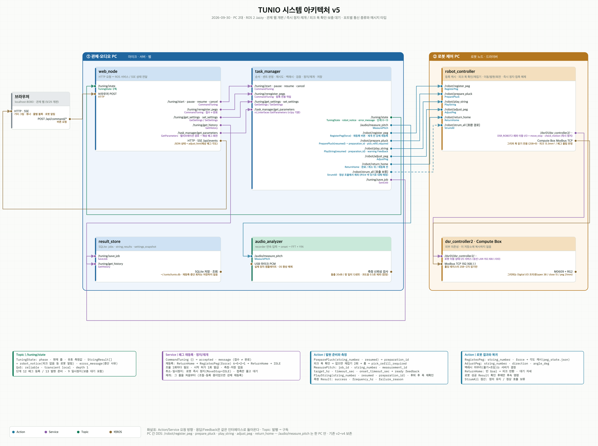

# TUNIO 시스템 아키텍처 v5

2026-09-30. main `c6ec065` 기준 (PR #110 · #111 · #113 · #114 · #115 반영).
v4(2026-09-23)의 PC 2대 구성과 노드 5개는 그대로다. 바뀐 것은 **관제 웹 개편, 취소·일시정지 즉시 정지와 재개 정책, 피크 폭 확인·재집기·보충 대기, 그에 따른 인터페이스 필드**다.
인터페이스가 충돌하면 [TUNIO_INTERFACE_SPEC.md](TUNIO_INTERFACE_SPEC.md)가 기준이다. v1~v4 파일은 보존한다.

[확대 가능한 SVG](TUNIO_시스템아키텍처_v5.svg) · [생성기](TUNIO_시스템아키텍처_v5.py) · 작업 흐름은 [TUNIO_작업흐름_v3](TUNIO_작업흐름_v3.png)

도식 읽는 법 — Action(청록) · Service(보라) · Topic(초록) · 비ROS(갈색). 노드의 입력 포트는 왼쪽, 출력 포트는 오른쪽. 화살표는 요청 방향이고 응답·Feedback은 같은 인터페이스로 돌아온다. StrumAll은 정의만 남아 점선이다.

## v4 이후 변경

- **관제 웹 개편 (#107 → #111)** — 기타 그림 위에 줄·페그 상태, 튜너 게이지, 줄별 세로 블록, 호박색 「로봇 알림」 띠, **예상 페그 회전**(지금 오차로 로봇이 돌릴 각도). 예상 각도는 web_node가 task_manager와 같은 `tuning_logic.adjust_plan`을 부르고, 캘리브레이션 파일 경로는 `/task_manager/get_parameters`(rclpy 기본 서비스)로 받는다. 글꼴은 저장소에 동봉해 인터넷 없이 뜬다. 서버 API·실행 방법은 그대로다.
- **취소·일시정지 = 즉시 정지 (#111)** — 둘 다 로봇에 MoveStop을 보내고 CheckMotion IDLE을 확인한다. 정지가 확인되면 로봇은 접촉만 푼다(피크를 쥐고 있으면 열지 않고 +Z 30mm, 빈손이면 열고 폭 35mm 이상을 확인한 뒤 상승, 모르면 열지 않고 상승) 그 자리에서 대기하고 잠금을 푼다. **취소**는 서버가 `ReturnHome`을 보내 피크 반환·대기 자세 → CANCELED. **재개는 그 줄을 처음부터**이고, 멈춘 게 `adjust_peg`/`register_peg`였으면 손잡이가 반쯤 돌아간 상태라 그 줄만 강제 재등록 후 재개한다. 노드 재시작은 정지 확인·복구가 실패했을 때만 필요하다. (멈춘 자리에서 이어 가는 비동기 이동 방식(#106)은 9/29 실기에서 "목표 미도달"로 막혀 쓰지 않는다.)
- **피크 확인·재집기·보충 대기 (#88 → #115)** — `verify_pick:=true`일 때 집기 직후·발현 후 후퇴 뒤·재개 직후에 그리퍼 폭으로 피크 유무를 본다(13.3mm 이상 = 있음, 읽기 2회 실패 = 없음). 없으면 재집기 2회, 소진하면 홈 복귀 후 Result의 `pick_refill_required=true`로 끝낸다. 서버는 오류 대신 PHASE_PAUSED로 기다리고 `robot_notice`를 화면에 띄운다. 사람이 피크를 채우고 웹 「재개」를 누르면 같은 줄 발현 준비부터 다시 하며, 다음 PreparePluck/PlayString Goal에 `resumed=true`를 실어 로봇이 피크를 다시 확인한다. 기본값은 아직 false다.
- **재등록은 먼저 ReturnHome (#115)** — 홈이 아닌 자리에서 첫 페그로 바로 가지 않는다.
- **로봇 이동 (#110 · #113 · #114)** — 집기·반환·발현 준비 때 고정 홈 왕복을 생략하고 현재 팔 모양을 유지하는 높이 경로로 잇는다. 오른쪽→왼쪽(6·5번) 전환은 접기 → J1 회전 → 접근. J6 360도 동등각 보정, 오른쪽 페그 파지 방향은 J5 한계(±135도) 안의 높이에서 만든다. 페그 접근 관절 속도 상한 15 → 30도/s, 비접촉 경유는 `movej` 블렌딩(반경 10mm, 왼쪽 접힌 전환 2mm)으로 연결. `speed_scale` 6.0(사용자 실기 설정, 손끝 250mm/s 상한 유지).
- **인터페이스** — `TuningState`에 `robot_notice`·`error_message`. `PlayString`·`PreparePluck` Goal에 `resumed`, Result에 `pick_refill_required`, Feedback에 `warning`. 단계 번호와 기존 필드는 바꾸지 않았다.

## 노드와 책임

- **web_node** — HTTP 명령을 ROS 서비스로 전달하고 `/tuning/state`를 SSE로 보낸다. 시작·일시정지·재개·취소·페그 재등록, 설정, 이력 조회, 예상 페그 회전 계산. `127.0.0.1:8080`에만 바인딩한다.
- **task_manager** — 조율/재등록 실행 잠금, 줄 순서(6→5→2→1), 재시도 한도, 백래시 마무리 결정, 1차 성공 줄 검증, 상태 발행, 저장 요청, 취소·일시정지 요청을 로봇 goal 취소로 전달. 설정 서비스도 여기.
- **audio_analyzer** — MeasurePitch Goal을 받았을 때만 녹음·분석. onset을 스스로 검출하고 과도음 0.5초를 뺀 안정 구간을 FFT + YIN으로 잰다. 돌출 20dB · 창 일치 12센트 관문.
- **result_store** — `save_job` / `get_history`. SQLite에 작업·줄별 결과·당시 설정 스냅샷. 재등록 회차와 중간에 끊긴 작업은 저장하지 않는다.
- **robot_controller** — 페그 각도 캐시(`peg_state.json`), 피크 집기/반환과 폭 확인, 발현, 페그 회전, 복귀, 즉시 정지와 접촉 해제, 동시 실행 거부. 두산 드라이버와 Compute Box는 외부 의존성.

## 통신 계약 (요약)

### 웹 ↔ 서버

- `POST /api/command/{start|pause|resume|cancel|reregister_pegs}` → 같은 이름의 `/tuning/*` 서비스(CommandTuning, 빈 요청). `accepted`는 접수 여부이지 완료·물리 정지가 아니다.
- `GET /api/events` SSE — `TuningState`를 JSON으로 + `adjust_hint`(예상 페그 회전). `GET /api/state` · `/api/settings` · `/api/history`.
- `/tuning/state` — reliable · transient local · depth 1. 늦게 켠 브라우저도 마지막 상태를 받는다.

### 서버 ↔ 로봇 (PC 사이, DDS)

- `RegisterPeg(string_number, force)` → success · message. 재등록 버튼은 force=true. 재개 전 강제 재등록에도 쓴다.
- `PreparePluck(string_number, resumed)` → success · message · `preparation_id` · `pick_refill_required`. Feedback `warning`.
- `PlayString(string_number, resumed, preparation_id)` → success · message · `pick_refill_required`. Feedback `warning`. 준비 식별자는 같은 줄에 한 번만 쓴다.
- `AdjustPeg(string_number, direction, angle_deg)` → success · message. 방향·각도만 수행하고 백래시 마무리는 서버가 결정한다.
- `ReturnHome()` → success · message. 완료 뒤, 취소 뒤, 재등록 전.
- 취소·일시정지는 별도 서비스가 아니라 **진행 중인 goal의 취소 요청**이다. 로봇이 MoveStop → IDLE 확인 → 접촉 해제 → 잠금 해제 후 Result를 돌려준다.

### 서버 ↔ 마이크 (같은 PC)

- `MeasurePitch(job_id, string_number, measurement_id, target_hz, timeout_sec, onset_timeout_sec)` → Feedback `ready` → Result(식별자 3개 · success · frequency_hz · failure_reason).
- 로봇 준비가 끝난 뒤에만 마이크를 요청하고, ready를 받은 뒤에만 발현한다. 타임아웃은 onset 검출 시점부터 센다. 늦게 온 이전 결과는 식별자로 걸러낸다.

## 두 작업 흐름

- **페그 재등록** — 버튼 → CommandTuning 접수 → `ReturnHome` → PHASE_REGISTER_PEG(12)에서 `RegisterPeg(force=true)` 6→5→2→1 → PHASE_RETURN(7) → IDLE(0), 빈 job_id. 시작 허가 1회 발급. 측정·조율·저장 없음.
- **조율** — 시작(허가 소비) → 줄마다 [PreparePluck → MeasurePitch ready → PlayString → 분석 → 필요하면 피크 반환·AdjustPeg → 다시] → 1차 성공 줄 검증 → ReturnHome → 완료·저장. 완료·오류·취소 뒤 다음 조율은 재등록부터.

자세한 흐름과 판정 기준은 [TUNIO_작업흐름_v3](TUNIO_작업흐름_v3.png), 결정의 근거는 `CLAUDE.md` 3~5절.

## 아직 임시값·미검증인 것

- 취소 복구 `cancel_lift_mm` 30 · `cancel_open_confirm_mm` 35 · 정지 확인 5초 / 0.1초 · `prepare_timeout_sec` 30(실측 50~74초라 짧다)
- 피크 폭 문턱 13.3mm(조건당 2회 표본) · `verify_pick` 기본값 false
- `speed_scale` 6.0 · 경유 블렌딩 반경 · 30도/s 상한 — 실물 경로·속도 검증 전
- 오른쪽 페그의 낮은 높이 손목 회전이 헤드스톡을 쓰는지
