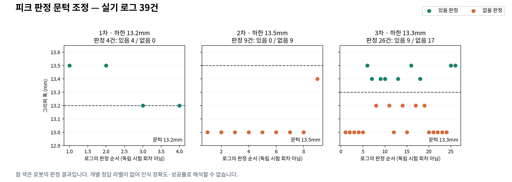

# 피크 유무 판정 실기 시험 결과

박성현 · 로봇 파트 · 시험일 2026-09-23

## 발표 핵심

**그리퍼 폭으로 피크 유무를 판정하고, 실기에서 발견한 오인 사례를 반영해 판정 하한을 13.2 → 13.5 → 13.3mm로 조정했다. 확보한 판정 기록은 총 39건이다. 재집기 소진 후 홈 복귀와 보충 후 재개 동작도 실기 로그로 확인했다.**

여기서 1·2·3차는 같은 조건으로 반복한 독립 시험이 아니라, 문턱값을 바꾼 개발 단계를 사후에 구분한 것이다. 한 동작에서 집기 직후와 타현 후 각각 판정할 수 있으므로, 판정 39건은 집기 39회 또는 조율 39회를 뜻하지 않는다.

## 슬라이드 1 — 판정 방법

- 측정 대상: 닫힘이 안정된 그리퍼의 폭. TCP 좌표나 파지 감지 플래그를 사용하지 않는다.
- 측정 경로: RG2 Compute Box의 Modbus 폭 읽기. 분해능 0.1mm.
- 확인 시점: 피크 집기 직후, 타현 후 후퇴한 다음, 피크가 필요한 구간에서 일시정지 후 재개할 때.
- 현재 기준: **13.3~16.0mm이면 피크 있음**, 범위 밖이면 없음.
- 폭 읽기 2회 실패도 없음으로 처리한다. 아래 39건은 숫자 폭이 남은 판정만 집계한 것이며, 통신 실패 시험 횟수가 아니다.

사전 측정 기록(2026-09-22): 빈손 13.0mm, 피크 2장 13.7mm, 차이 0.7mm. 조건별 2회라는 설정 파일의 요약 기록이다. 이번 39건과 합산하지 않으며, 원시 측정 파일이 확보된 반복 시험으로 표현하지 않는다.

## 슬라이드 2 — 1차·2차·3차 결과

### 1차: 판정 하한 13.2mm

- 확보 기록: **4건**, 폭 **13.2~13.5mm**.
- 로봇 판정: 있음 **4건**, 없음 **0건**.
- 발견 문제: 빈손인데 13.2mm가 측정되어 피크 있음으로 통과한 사례. 사용자 육안 보고와 설정 변경 주석이 근거다.
- 조치: 빈손을 통과시키지 않도록 하한을 13.5mm로 높였다.

### 2차: 판정 하한 13.5mm

- 확보 기록: **9건**, 폭 **13.0~13.4mm**.
- 로봇 판정: 있음 **0건**, 없음 **9건**.
- 발견 문제: 실제로 피크를 집었다는 사용자 보고에도 **13.4mm를 없음으로 판정**했다. 기준이 높아 정상 파지를 거부한 사례다.
- 조치: 하한을 13.3mm로 낮췄다.

### 3차: 판정 하한 13.3mm

- 확보 기록: **26건**, 폭 **13.0~13.5mm**.
- 로봇 판정: 있음 **9건**, 없음 **17건**.
- 있음 판정 폭: **13.4mm 5건, 13.5mm 4건**.
- 없음 판정 폭: **13.0mm 12건, 13.2mm 5건**.
- 결과: 확보 로그에서 13.2mm는 없음, 13.4mm는 있음으로 구분되며, 재집기·홈 대기·보충 후 재개 동작을 확인했다.
- 한계: 경계와 가까운 관측값은 양쪽 모두 0.1mm 차이뿐이다. 반복 파지와 피크 상태 변화에 대한 추가 확인이 필요하다.

**위의 있음/없음 건수는 로봇이 내린 판정의 분포다. 인식 성공/실패 건수나 정확도가 아니다.** 시험자가 의도적으로 빈손 상황을 만들었으므로 없음 판정 자체는 인식 실패가 아니다. 개별 기록마다 실제 피크 유무를 따로 남기지 않아 정확도와 오인율은 계산하지 않았다.

## 슬라이드 3 — 예외처리와 복구 실기 결과

마지막 세션의 연속된 2개 Action 결과로 확인했다. 이 세션의 폭 판정 5건은 위 3차 26건에 포함된다.

1. **빈손 → 재집기 소진 → 홈 복귀: 확인 1건**
   - 첫 집기 13.0mm → 추가 재집기 1회 13.0mm → 추가 재집기 2회 13.0mm.
   - 홈 복귀 완료 후 “피크를 재보충하고 재개 버튼을 누르세요” 결과를 반환했다.
   - 요청부터 홈 복귀 완료 결과까지 **29.70초**.
   - Action의 `success: false`는 정상 발현을 완료하지 못했다는 뜻이다. 이번 빈손 시험에서는 의도한 예외처리 결과다.

2. **보충 후 재개 → 새 집기 → 타현: 확인 1건**
   - `resumed: true` 요청 후 집기 확인 13.5mm → 타현 후 확인 13.5mm.
   - Action `success: true`로 완료했다.
   - 재개 요청부터 완료까지 **25.16초**. 사람의 보충 대기 시간은 포함하지 않는다.

이는 **로봇 Action을 직접 요청한 실기 결과**다. 관제 웹 버튼부터 서버를 거쳐 복구하는 전체 연결의 실기 검증 결과로 확대해서 발표하지 않는다. 소요 시간도 각 1회 참고값으로, 평균이나 최대 보장 시간이 아니다.

## 그대로 읽을 발표 문장

> 피크가 있는지는 그리퍼가 닫혔을 때의 폭으로 판단합니다. 1차에서는 기준을 13.2mm로 두었지만 빈손이 통과하는 문제가 있었습니다. 2차에서 13.5mm로 높이자 피크를 잡은 13.4mm까지 없다고 판단했습니다. 그래서 3차에서는 13.3mm로 조정했습니다. 총 39건의 판정 로그를 확보했고, 마지막 시험에서 재집기 두 번 실패 후 홈 복귀, 보충 후 재개하여 다시 집고 줄을 튕기는 동작을 확인했습니다. 현재 자료는 기준 조정과 예외처리 검증 결과이며, 인식 정확도는 정답을 함께 기록하는 반복 시험으로 별도 검증할 예정입니다.

## 정확도를 발표하려면 추가로 기록할 항목

- 같은 설정에서 빈손과 실제 파지를 각각 최소 20회 독립적으로 여닫아 시험한다. 같은 닫힘 상태에서 센서만 여러 번 읽은 값은 별도 파지 시험으로 세지 않는다.
- 매회 실제 상태(육안), 측정 폭, 로봇 판정, 확인 시점, 재집기 횟수, 최종 결과를 함께 남긴다.
- 인식 정확도 = 실제 상태와 판정이 일치한 횟수 ÷ 전체 유효 시험 횟수.
- 빈손 오인율 = 실제 빈손을 있음으로 판정한 횟수 ÷ 실제 빈손 시험 횟수.
- 파지 누락률 = 실제 파지를 없음으로 판정한 횟수 ÷ 실제 파지 시험 횟수.
- 통신 실패와 웹 재개는 별도 시나리오로 시험한다. 내부 소프트웨어 테스트 통과 수를 실기 인식 성공률에 합산하지 않는다.

## 근거 자료

- [판정 39건 CSV](width_observations.csv): 단계, 문턱값, 시각, 폭, 판정, 원본 로그 파일명과 행 번호. `ground_truth`는 정답 미기록으로 비워 두었다.
- [단계별 집계 JSON](summary.json).
- [발표용 PNG](pick_threshold_trials.png) / [확대 가능한 SVG](pick_threshold_trials.svg).
- [최종 Action 실행 기록](evidence/2026-09-23_165540_node_session.json).
- 설정과 변경 근거: `src/tunio_robot/config/teach_points.yaml`의 `pick_stack` 및 그 주석. 육안 결과는 시험 중 사용자 보고를 사용했으며 개별 CSV 행의 정답으로 소급 입력하지 않았다.

원본 ROS 로그 사본은 `evidence/`에 보존했다. 수집 대상은 아래 6개 파일이며, 확보된 로그에 한정한 집계다.

- 1차: `python3_225612_1790127380914.log`
- 2차: `python3_232332_1790129667270.log`, `python3_266332_1790144460665.log`, `python3_267326_1790144809157.log`
- 3차: `python3_271386_1790145782139.log`, `python3_293882_1790150140488.log`
