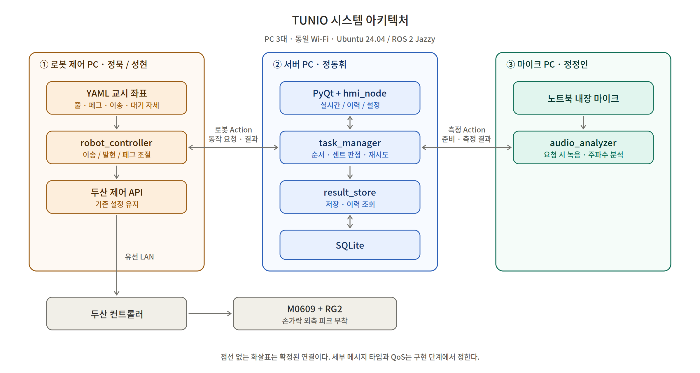
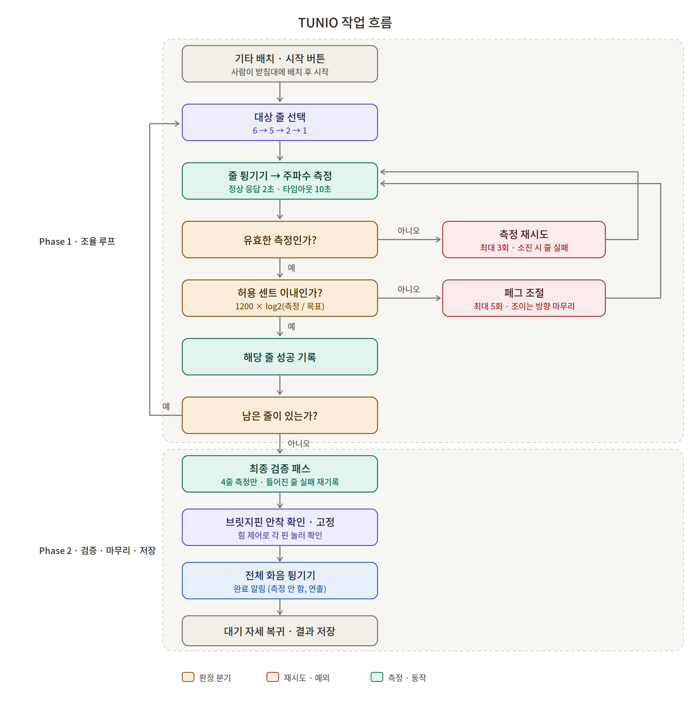

# TUNIO — 협동로봇 기타 자동 조율 시스템

> 로봇팔 한 대가 기타 줄을 튕겨 주파수를 측정한 뒤 페그를 조절해 정밀 조율하고, 최종 검증까지 수행한다. 기타 배치·회수는 사람이 한다.

**시연 2026-09-29 · 발표 2026-09-30** · 문서 상태: 기획 기준본 v1.2 (인터페이스 확정 반영)

> v1.1 대비: 브릿지핀 안착 확인 범위 제외 / 백래시 마무리 주체 = 서버 / 측정 타임아웃 기준 = 오디오 onset / 설정 Service = task_manager / 허용 센트 시작값 10.
> v1.2 이후 갱신(2026-09-19): 정상 응답 목표 2초 → 2.2초 / 마이크 USB 외장 마이크로 확정(구매 완료).
> 인터페이스 세부는 `docs/TUNIO_INTERFACE_SPEC.md`가 기준본이다.

---

## 1. 목표

기타 제조 공장에서 사람이 대략 조율한 기타의 **정밀 조율**을 자동화한다.

- **해결할 문제**: 반복 수동 조율과 작업자별 품질 편차
- **목표 가치**: 반복 작업 대체, 측정 기반 일관된 조율, 결과 이력 관리
- **시연 범위**: 실제 기타 **6·5·2·1번 줄**, 한 번에 한 대. 사람이 받침대에 배치·회수
- **교육 목적**: 두산 API 로봇 제어, ROS 2 분산 노드(Action/Service/Topic), 센서 데이터 처리, PyQt·SQLite 통합

### 작업 구성 (2 Phase)

- **Phase 1 · 조율 루프 (핵심)** — 줄 튕기기 → 측정 → 판정 → 페그 조절을 4개 줄에 반복.
- **Phase 2 · 검증·마무리·저장** — 4줄 최종 검증(측정만) → 전체 화음 한 번(측정 안 함, 완료 알림) → 복귀·저장.

기타 배치·회수는 사람이 하며, 로봇 이송 동작은 이번 범위에서 제외한다.

### 왜 4줄만 하는가 (예상 질문)

저음역(6·5번)과 고음역(2·1번) 양극단을 포함해 주파수 분석 알고리즘의 검증 범위를 확보하면서, 시연 시간과 개발 기간을 관리하기 위한 선택이다. 4번·3번 줄은 동일 로직으로 확장 가능하며 좌표 교시만 추가하면 된다.

### 경제성 (가정 기반 시나리오, 실측 아님)

가정: 하루 80대 / 연 365일 / 대당 인력 5분→1분 / 시간당 12,000원

- 연간 처리량 29,200대, 인력 투입 시간 **80% 절감**
- 연간 약 1,947시간, **약 2,336만 원** 상당의 인력 활용 가치

> 완전 무인이 아니며 사람의 배치·시작·회수를 1분에 포함한 값이다. 순절감액이나 회수기간이 아니고, 4개 줄 공정의 값을 6현 전체나 공장 전체로 확대하지 않는다. 최저임금 10,320원으로 환산하면 20,090,600원이다. **실제 사이클 타임은 9/22 통합 테스트에서 실측한 뒤 이 수치를 재계산한다.**

### 향후 확장 — 악기 진단 리포트

본 시스템은 조율 결과뿐 아니라 측정 주파수·조절 횟수·페그 회전 저항을 기록하므로, 이를 확장하면 **줄 장력 이상, 페그 헛돎, 넥 변형 의심** 같은 악기 상태 진단이 가능하다. 기존 자동 조율기(1악기 1장착)와 달리 로봇 1대가 다수 악기를 무인 순회하며 상태 데이터를 축적한다는 점이 차별점이다. 본 기간에는 구현하지 않으며 향후 과제로 둔다.

---

## 2. 조율 기준

**A4 = 440Hz, 12평균율 고정.** UI에서 목표 주파수는 변경하지 않는다.

- 1순 — 6번 E2 — 약 82.4069Hz
- 2순 — 5번 A2 — 110Hz
- 3순 — 2번 B3 — 약 246.9417Hz
- 4순 — 1번 E4 — 약 329.6276Hz

**판정은 센트, 화면 표시는 Hz.**

- 센트 오차 = `1200 × log2(측정 / 목표)`, 절댓값이 허용 센트 이내이면 성공
- 화면 오차 = `측정 − 목표` (Hz). 양수는 높은 음, 음수는 낮은 음
- 허용 센트는 **10센트로 시작**하고 테스트 후 확정 (빡빡하게 시작하면 수렴 실패 원인이 기준 탓인지 회전량 탓인지 구분 안 됨)

### 페그 조절 방향 — 백래시 대응

페그 웜기어에는 백래시가 있어 조임/풀림 방향에 따라 같은 각도에도 결과가 달라진다.
**최종 접근은 항상 조이는 방향으로 통일한다.** 목표보다 높으면 목표 아래로 충분히 풀었다가 조여 올린다.

**이 판단은 서버(`task_manager`)가 한다.** 로봇은 요청받은 방향·각도만 수행하므로 조절 1회가 goal 2번이 될 수 있다.

### 재시도 규칙

- 페그 조절: 줄당 최대 **5회** (임시값)
- 측정 실패 시: 페그를 돌리지 않고 **추가 최대 3회** 재측정
- 측정 응답: **정상 응답 목표 2.2초, 타임아웃 10초.** 타임아웃 초과 시 측정 실패 처리. 10초는 녹음 길이가 아니라 응답 제한이다
- 목표를 2초에서 2.2초로 올렸다(2026-09-18). 저음현은 녹음 2.0초가 필요해 6번 줄 실측이 약 2.05초라 2초로는 맞출 수 없다. 녹음 길이는 줄마다 다르다(고음 1.5초, 저음 2.0초). 3 PC 통신 지연은 미포함
- **타임아웃 카운트는 마이크가 오디오 onset(무음 → 소리)을 스스로 검출한 시점부터 센다.** 로봇 접근 시간이 제한 시간에 먹히지 않는다
- onset이 **onset 제한 시간(임시 10초)** 안에 안 들어오면 발현 실패로 보고 '소리 부족' 처리. 이 상한이 없으면 소리가 안 날 때 측정이 끝나지 않는다
- 조절·측정 재시도 모두 소진 → 해당 줄 실패 기록 후 다음 줄
- 실패 사유: 소리 부족 / 주파수 판별 불가 / 응답 시간 초과 / 서버 취소로 중단
- 유효 측정값 없음 → 화면 '측정 불가', DB 주파수 NULL (0Hz를 유효값으로 쓰지 않음)

### 최종 검증 패스

4줄 조율이 끝나면 **페그 조절 없이 4줄을 다시 측정만 한다.**
한 줄을 조이면 넥이 미세하게 변형되어 먼저 맞춘 줄이 틀어질 수 있기 때문이다.

- 검증에서 허용 센트를 벗어난 줄은 **실패로 재기록**하고 사유를 '검증 시 틀어짐'으로 남긴다
- 전체 결과 판정은 검증 패스 결과를 기준으로 한다
- 시간 여유가 있으면 검증 후 2차 조율 순회를 추가한다 (테스트 후 결정)

### 사용자 명령

- **시작** — 로봇·마이크 준비 완료 + 진행 작업 없음일 때만 활성화
- **일시정지** — 현재 위치 정지, 파지 유지
- **재개** — 중단 지점부터 이어서 진행
- **취소** — 정지·파지 유지, 자동 복귀 없이 종료, 저장 안 함

취소 후에는 사람이 정리하고 새 작업으로 처음부터 시작한다. 두산 기존 제어·안전 설정은 변경하지 않는다.

---

## 3. 시스템 아키텍처

- **서버 PC (정동휘)** — 작업 판단, PyQt 화면, SQLite 저장·조회
- **로봇 제어 PC (정묵·성현)** — 두산 API로 로봇·그리퍼 동작 실행
- **마이크 PC (정정인)** — 녹음 및 주파수 분석

공통 환경 Ubuntu 24.04 / ROS 2 Jazzy. PC 3대는 동일 Wi-Fi, 로봇 컨트롤러는 유선 LAN.

### 노드와 책임

- `task_manager` (서버) — 작업 순서, 센트 판정, 조절 방향·양(백래시 마무리 판단 포함), 재시도·검증 패스·상태 관리, 설정 보유 및 조회·변경 Service 제공
- `hmi_node` (서버) — PyQt 명령과 ROS 2 상태 연동
- `result_store` (서버) — SQLite 접근, 저장·이력 조회
- `robot_controller` (로봇) — 발현·페그 조절·화음 Action, 두산 API 연동
- `audio_analyzer` (마이크) — 측정 Action, 녹음 준비·분석·결과 반환

> 마이크의 '측정 성공'은 유효한 주파수를 얻었다는 뜻이고, '조율 성공' 판정은 `task_manager`가 한다.

---

## 4. 작업 흐름

작업 중 줄별 결과는 모아두었다가 정상 절차가 끝나면 한꺼번에 저장한다.

### 일시정지 · 재개 · 취소

작업 진행 중 → (pause) 현재 위치 정지·파지 유지 → (resume) 중단 지점부터 재개
진행 중 또는 일시정지 상태 → (cancel) 정지·파지 유지 → 자동 복귀 없이 종료, DB 저장 안 함 → 사람이 정리 후 새 작업 시작

### 측정과 발현의 동기화

1. `task_manager` → `audio_analyzer` : measure_pitch Goal (작업 ID·줄 번호·측정 ID)
2. `audio_analyzer` → `task_manager` : Feedback — 녹음 준비 완료
3. `task_manager` → `robot_controller` : play_string Goal (줄 번호)
4. 로봇이 부착 피크로 줄 튕기기 → 즉시 5mm 이상 후퇴 (버징 방지)
5. `audio_analyzer` onset 검출 시점부터 타임아웃 카운트, 발현 직후 과도음 구간을 제외한 안정 구간 분석 → Result (ID·주파수·성공 여부·실패 사유)
6. `task_manager` 센트 기준 조율 판정

마이크는 계속 분석하지 않고 요청 시에만 측정한다. 발현 시점을 로봇이 따로 알려주지 않고 마이크가 소리로 직접 판단한다.

---

## 5. 장비와 기구물

- **로봇팔** 두산 M0609 1대 · **그리퍼** RG2
- **악기** 실제 기타(스틸 줄), 6·5·2·1번 줄 사용
- **받침대** 눕힌 기타를 지지하되 페그 부분은 띄움
- **피크·홀더** RG2 손가락 바깥쪽 부착. 피크 집기·반환 동작 없음
- **마이크** USB 외장 마이크로 확정(구매 완료). 노트북 내장은 게인 조절 폭이 좁고 로봇 옆 배치가 불리해 쓰지 않는다. OS의 마이크 향상 기능(노이즈 제거·자동 음량·에코 제거)은 끈다
- **PC 3대** Ubuntu 24.04 / ROS 2 Jazzy · **UI·DB** PyQt, SQLite · **좌표** YAML

3D 프린터 사용이 어려우므로 기성품 우선, 없으면 상자로 제작한다. 좌표는 축 정렬 후 직접 교시하고 후처리로 보정한다. 페그는 직접 잡아 돌리며, 실물에서 불가능하면 대체 방식을 검토한다.

---

## 6. ROS 2 인터페이스

### Action

- `/robot/strum_all` — 전체 줄 훑어 화음 (측정 없는 연출)
- `/robot/play_string` — 줄 번호 → 교시 위치에서 발현
- `/robot/adjust_peg` — 줄 번호, 높이기/낮추기, 각도(°). 조이는 방향 마무리 규칙은 `task_manager`가 결정
- `/audio/measure_pitch` — 작업 ID, 줄 번호, 측정 ID, 목표 주파수, 응답 제한 시간, onset 제한 시간 → 준비 Feedback, 측정 Result

측정 Result는 요청 식별자 3개와 주파수·성공 여부·실패 사유를 포함한다. 늦게 도착한 이전 결과가 현재 결과로 쓰이지 않도록 요청과 대조한다.

**세부 타입·필드·열거값은 `docs/TUNIO_INTERFACE_SPEC.md`가 기준본이다.** 이 문서와 다르면 그쪽을 따른다.

### Service

`/tuning/start` · `/tuning/pause` · `/tuning/resume` · `/tuning/cancel` · `/tuning/get_history` · `/tuning/get_settings` · `/tuning/set_settings` · `/tuning/save_job`

버튼 Service 4개는 요청 필드 없는 같은 타입을 공유하며, 어느 이름으로 불렸는지가 곧 명령이다. 접수 여부만 응답하고 실제 진행은 Topic으로 알린다.

**설정 조회·변경은 `task_manager`가 제공한다.** 설정을 보유하고 작업 진행 여부를 아는 유일한 노드라 '작업 중이면 거부'를 스스로 판단할 수 있다.
`/tuning/save_job`은 정상 종료 시 `task_manager` → `result_store` 일괄 저장 요청이다.

### Topic

`/tuning/state` 하나에 작업 단계, 현재 줄, 목표·측정 주파수, Hz 오차, 조절 횟수, 줄별 결과, 적용 중인 설정을 묶어 전달한다. QoS는 reliable·depth 1·transient local이라 늦게 켠 UI도 마지막 상태를 즉시 받는다.

- 작업 상태: 대기 / 측정 준비 / 발현 / 분석 / 페그 조절 / 최종 검증 / 화음 마무리 / 복귀 / 완료 / 일시정지 / 취소 / 오류
- 전체 결과: 최종 검증 기준 4줄 모두 성공 → **성공**, 일부 → **부분 성공**, 전부 실패 → **실패**
- 절차 완료와 조율 성공은 다르다. 부분 성공·실패여도 정상 종료 절차를 마치고 저장한다.

---

## 7. UI와 저장

**탭 3개**

- 실시간 작업 — 조작 버튼, 작업 단계·현재 줄·주파수·Hz 오차·조절 횟수·줄별 결과·검증 결과
- 작업 이력 — 최신순 목록, 선택 시 줄별 상세
- 설정 — 허용 센트, 최대 조절 횟수, 측정 재시도 횟수, 측정 제한 시간, onset 제한 시간, 기본값 초기화

설정은 작업 시작 전에만 변경하고 작업 중에는 잠근다. 목표 주파수는 UI 변경 대상이 아니다.

**저장**

- 서버 PC의 SQLite. 별도 JSON 없음
- 한 대 작업이 끝나면 일괄 저장. 취소 작업과 부분 결과는 저장하지 않음
- 테이블 3개: 작업 전체 결과 / 줄별 결과 / 조율 설정
- 줄별 결과에 조율 직후 값과 최종 검증 값을 모두 기록한다
- 당시 적용한 설정 5개(허용 센트·최대 조절 횟수·측정 재시도 횟수·측정 제한 시간·onset 제한 시간)를 함께 보존 (이후 설정 변경으로 과거 기준이 바뀌지 않도록)
- 결과·실패 사유는 정수 열거값으로 저장. **기존 번호를 바꾸면 과거 기록이 조용히 재해석되므로 뒤에 추가만 한다**

---

## 8. 일정

**9/24~28은 작업을 배정하지 않는다.**

- **9/17~18** 기구물 준비·교시 착수, 인터페이스 필드 합의, 발현·페그 조절 단위 테스트, 실제 기타 녹음 첫 동작. UI는 모의값으로 개발
- **9/19~20** 주말, 필수 작업 없음
- **9/21 오전** 발현·페그 조절 단위 테스트 완료, 마이크 모듈 전달, 서버·UI·DB 준비 — **핵심 의존성**
- **9/21 오후** 실제 측정값으로 통합 시작, 한 줄 연결 동작 검증
- **9/22** 4개 줄 전체 작업 + 최종 검증 + 화음 마무리, 버튼·재시도·제한 시간·저장·조회 검증, **사이클 타임 실측**
- **9/23 오전** 잔여 결함 수정과 반복 테스트
- **9/23 오후** 리허설, 코드·좌표·설정 보관
- **9/29** 최종 시연 / **9/30** 발표

**지표**: 줄별 조율 성공률(최종 검증 기준), 최종 Hz 오차, 한 대당 총 작업 시간. 목표 수치는 초기 테스트 후 결정.
사람과의 직접 비교 실험은 하지 않는다. 성능 실측과 경제성 가정 계산을 발표에서 구분한다.

---

## 9. 담당자별 체크리스트

**정묵 — 페그 조절**
RG2 페그 파지·파지력 범위 확인 / 페그별 좌표·자세 교시 및 YAML 정리 / 줄별 회전 방향 검증 / **백래시 영향 실측: 조임/풀림 방향별 결과 차이 확인 후 정동휘와 공유** (조이는 방향 마무리 판단은 `task_manager`가 하고, 로봇은 시킨 방향·각도를 정확히 수행) / `/robot/adjust_peg` 구현·단위 테스트 / 피크와 주변 구조물 간섭 확인 / 오차별 회전량 계산 결과 공유

**성현 — 줄 튕기기**
피크 홀더 마련·고정 / 그리퍼 폭·피크 끝 위치·접근 자세 검증 / 4개 줄 좌표·동작 교시 및 YAML / **발현 직후 5mm 이상 후퇴 동작 포함** / `/robot/play_string` 구현·반복 테스트 / 발현 시점 및 측정 트리거 전달 방식 합의

**정묵·성현 공동 — 로봇 제어 공통**
세 Action의 충돌 없는 처리 정리 / 일시정지·재개·취소와 파지 유지의 실제 API 검증 / 교시 대기 자세 테스트

**마무리 동작 (정묵·성현)**
전체 화음 strum_all 동작 교시·구현 (측정 없음)

**정정인 — 마이크·분석**
4개 줄 실제 녹음 확보 / YIN 등 후보 비교 후 알고리즘·분석 구간 선정 / **탐색 범위를 대상 줄 목표 주파수 ±2반음으로 제한 (옥타브 오인 차단)** / 발현 직후 과도음 제외 구간 결정 / **onset(무음 → 소리) 검출 구현 — 준비 Feedback 직후부터 입력 감시, onset 시점이 제한 시간 기준. 임계값은 실측하며 확정** / **onset 제한 시간(임시 10초) 내 미검출 시 '소리 부족'으로 응답** / 유효 측정 판정 기준 검증 / `/audio/measure_pitch` 구현 / 요청 ID 일치 결과 반환 / 로봇 소음에서 onset 오검출 여부 확인 (구동음을 발현으로 오인하지 않을 것) / OS 마이크 향상 기능 해제 / **9/21 오전 통합 가능한 모듈 전달**

**정동휘 — 서버·UI·DB·받침대**
받침대 제작 및 배치·접근 확인 / `task_manager` 순서·센트 판정 구현 / 조절 5회·재시도 3회·응답 2.2초 목표·타임아웃 10초·onset 제한 10초 구현 / 허용 센트 기본값 10센트 / **최종 검증 패스 구현 및 틀어진 줄 실패 재기록** / 조이는 방향 마무리 규칙 (목표 이상이면 아래로 풀었다 조이기) / PyQt 3개 탭·설정 잠금 / 상태 Topic(transient local)·Service 연동 / **설정 Service를 task_manager에서 제공, 작업 중 변경 거부** / **정상 종료 시 save_job 저장 요청** / `result_store` 및 SQLite 3개 테이블 설계 (조율 직후·검증 값 병기) / 일괄 저장·취소 제외·NULL·설정 스냅샷 / 이력·상세 조회 검증 / 모의 결과로 서버 흐름 선행 테스트

**팀 공동 — 통합·시연**
메시지 타입·열거값·ID 규칙 합의 / PC 3대 Wi-Fi 및 로봇 유선 LAN 점검 / 시연용 파라미터 확정·기록 / 성공·부분 성공·실패 및 일시정지·재개·취소 통합 테스트 / **9/22 사이클 타임 실측 후 경제성 수치 재계산** / 9/23까지 리허설 및 산출물 보관 / 9/29 시연, 9/30 발표

---

## 10. 테스트 후 확정할 사항

- 허용 센트 확정값·회전량·분석 알고리즘 (허용 센트 10·조절 5회·타임아웃 10초·onset 제한 10초는 임시값)
- 정상 응답 목표 2.2초의 실현 가능 여부 — 마이크 단독은 6번 줄 약 2.05초로 확인. 통신 지연 포함 실측이 남았다
- 검증 후 2차 조율 순회 추가 여부
- 재시도 카운터 초기화 범위, 부분 실패 집계
- 기구물 재료·치수·고정·하중·간섭·반복성
- 두산·RG2 드라이버 버전, 파지력, 정지·재개 기능
- 측정 동기화 — 수음 구간, onset 검출 임계값 (타임아웃 기준 시점은 onset으로 확정)
- ROS 2 네트워크 설정 (메시지 타입·필드·QoS·ID·상태 코드는 인터페이스 명세로 확정됨)
- DB 테이블 키·컬럼, UI 입력 범위·배치
- 마지막 측정만 실패한 경우의 최종값 표기·보존
- 실제 사이클 타임과 그에 따른 경제성 재계산
- 프로젝트명 (TUNIO 임시)

### v1.2에서 확정된 것

- **백래시 마무리 주체 — 서버(`task_manager`).** 로봇은 시킨 방향·각도만 수행
- **측정 타임아웃 — 마이크가 직접 재고, 오디오 onset 검출 시점부터 카운트**
- **설정 Service 제공 노드 — `task_manager`**
- **브릿지핀 안착 확인 — 범위 제외.** 관련 Action·상태를 모두 걷어냄
- **완료 결과 저장 — `task_manager` → `result_store` save_job 호출**

### 보류한 예외

- **페그 회전축 불일치·걸림·재파지** — 대응 방식 미정
- **Wi-Fi 단절** — 연결 감시·자동 정지는 현재 구현 범위 밖
- **기타 오류** — 파지 실패, 취소 외 오류 종료 시 저장 방침 미정

---

## 부록. 주파수 분석 알고리즘 후보

**공통 과제**: 가장 큰 소리 성분이 아니라 줄의 기본 주파수(F0)를 추정해야 한다. 다른 줄의 공명과 로봇·실내 소음이 섞일 수 있다. 특히 6번 E2(82.4Hz)와 1번 E4(329.6Hz)는 두 옥타브 관계라 서로 공명하므로, **대상 줄의 목표 주파수 ±2반음으로 탐색 범위를 제한**해 옥타브 오인을 원천 차단한다.

- **YIN** — 시간 영역 차이 함수로 F0 추정. 우선 시험 후보. 발현 직후 과도음 제외 구간 확인 필요 (`librosa.yin`)
- **pYIN** — YIN에 확률·경로 추정 적용. 처리 시간과 안정성 비교 필요 (`librosa.pyin`)
- **MPM** — 정규화 차이 함수와 피크 선택, clarity 지표 제공. 구현체 유지 상태·라이선스 확인 필요
- **FFT/STFT 피크 + 보간** — 시각화와 비교 기준용. 최대 피크가 기본음이 아닐 수 있어 선택 규칙 필요

**비교 테스트 방법**: 같은 녹음 파일로 후보를 비교한다. 4개 줄 각각 목표 음 근처·약간 높음·약간 낮음, 로봇 소음 조건을 포함한다. Hz 오차, 반복 측정 변동(표준편차 1센트 이내 목표), 옥타브 오인 비율, 무음·잡음에서의 오검출, 응답 시간을 본다. 저음 줄을 위해 탐색 범위와 프레임 길이를 직접 지정하고 라이브러리 기본값을 가정하지 않는다. 실물 줄이 없는 동안은 온라인 톤 제너레이터의 정확한 주파수로 코드를 먼저 검증한다 (단, 노트북 스피커는 150Hz 아래를 재생하지 못하므로 저음 줄 검증은 실물로).

**참고**
- YIN 원 논문 — https://pubmed.ncbi.nlm.nih.gov/12002874/
- librosa F0 추정 — https://librosa.org/doc/dev/auto_tutorials/01-intro/03-f0.html
- librosa pYIN — https://librosa.org/doc/0.11.0/generated/librosa.pyin.html
- 두산 ROS 2 Jazzy — https://doosanrobotics.github.io/doosan-robotics-ros-manual/jazzy/index.html
- 두산 정지 API — https://doosanrobotics.github.io/doosan-robotics-api-manual/GL013304/mode/common/motion_execution/stop.html
- ROS 2 Action — https://docs.ros.org/en/rolling/Concepts/Basic/About-Actions.html
- OnRobot RG2 — https://onrobot.com/en/products/rg2-finger-gripper
- 최저임금위원회 — https://minimumwage.go.kr/minWage/policy/decisionMain.do
