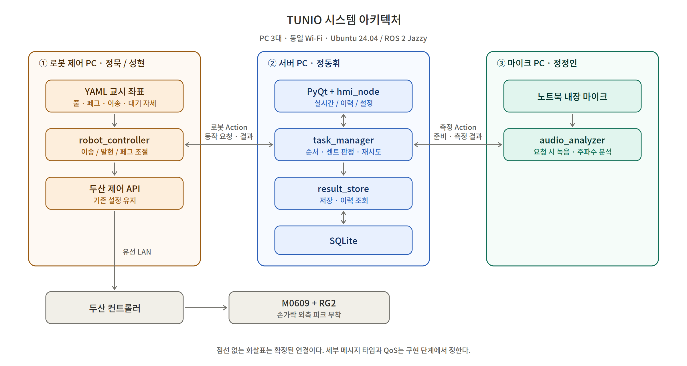
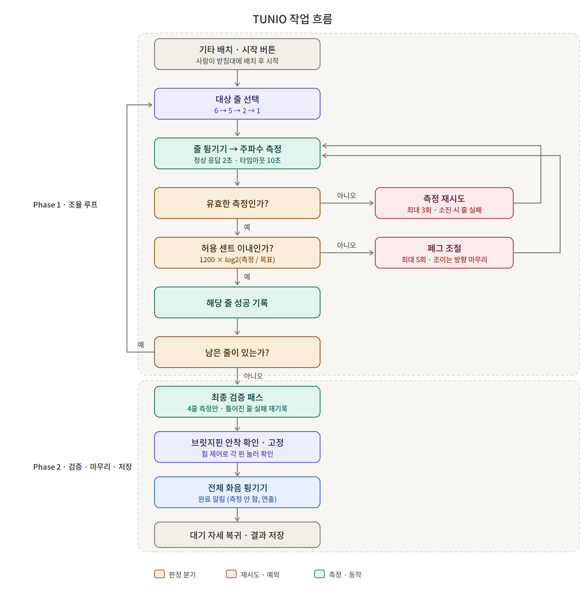

# TUNIO — 협동로봇 기타 자동 조율 시스템 · 프로젝트 기획서

> **Robotic Guitar Tuning** · 협동로봇 기반 기타 자동 조율·진단 시스템

- 문서 상태: **기획 기준본 v1.2 (인터페이스 확정 반영) — 구현 착수용**. 구현·검증 완료를 의미하지 않는다.
- v1.1 대비 변경: 브릿지핀 안착 확인 범위 제외, 백래시 마무리 주체를 서버로 확정, 측정 타임아웃 기준을 오디오 onset으로 확정, 설정 Service 제공 노드를 task_manager로 확정, 허용 센트 시작값 10센트. 인터페이스 세부는 `docs/TUNIO_INTERFACE_SPEC.md`가 기준본이다.
- v1.2 이후 갱신(2026-09-19): 정상 응답 목표 2초 → **2.2초**, 마이크 **USB 외장 마이크로 확정(구매 완료)**.
- 최종 시연 **2026-09-29** / 발표 **2026-09-30**.
- 본문은 최종 합의, 체크리스트는 구현할 일, 부록은 검토 자료와 근거를 담는다. 미결정·보류 사항은 12절에 구분한다.
- TUNIO는 임시 이름이며 최종 이름은 추후 결정한다.

## 목차

1. 목표와 가치
2. 요구사항과 조율 기준
3. 핵심 기술 검토 — 음향 방식 선택 근거
4. 시스템 아키텍처
5. 작업 흐름
6. ROS 2 노드와 책임
7. 장비·기구물·소프트웨어
8. 네트워크
9. ROS 2 인터페이스
10. PyQt 화면과 데이터 저장
11. 개발 일정과 검증
12. 담당자별 체크리스트
13. 테스트 후 결정 사항과 보류 예외

---

## 1. 목표와 가치

기타 제조 공장에서 사람이 대략 조율한 기타의 **정밀 조율**을 자동화한다. 로봇팔 한 대가 줄을 튕겨 주파수를 측정하고, 페그를 조절해 목표 음정에 맞춘 뒤, 최종 검증까지 수행한다.

**해결할 문제**
줄마다·기타마다 반복하는 수동 조율 작업과, 작업자 숙련도에 따른 품질 편차.

**목표 가치**
반복 작업 대체, 측정 주파수 기반의 일관된 조율, 작업 결과 이력 관리.

**시연 범위**
실제 기타의 6·5·2·1번 줄, 한 번에 한 대. 입력은 사람이 대략 조율해 받침대에 놓은 상태.

**교육 목적**
두산 API 로봇 제어, ROS 2 분산 노드(Action/Service/Topic), 센서 데이터 처리, PyQt·SQLite 통합.

### 1.1 왜 비전을 쓰지 않는가

장비 제약이 아니라, 이 문제에서 비전이 **원리적으로 무의미**하기 때문이다.

- 조율의 판단 근거인 **음정(주파수)은 광학적으로 관측 가능한 물리량이 아니다.**
- 줄 장력 역시 겉모습으로 드러나지 않는다. 정상 장력과 이상 장력의 외관은 동일하다.
- 따라서 "카메라 성능을 높이면 해결되는 문제"가 아니며, 음향과 힘/토크 센싱이 본질적 수단이다.

### 1.2 작업 구성 (2 Phase)

- **Phase 1 · 조율 루프 (핵심)** — 사람이 받침대에 놓은 기타에 대해 줄 튕기기 → 측정 → 판정 → 페그 조절을 4개 줄에 반복한다. 프로젝트의 핵심이며 가장 먼저 완성한다.
- **Phase 2 · 검증·마무리·저장** — 4줄을 다시 측정만 하는 최종 검증 패스를 거친 뒤, 전체 화음을 한 번 튕겨 완료를 알리고, 대기 자세 복귀·결과 저장.

기타는 사람이 받침대에 배치·회수한다. 로봇이 기타를 옮기는 이송 동작은 이번 범위에서 제외한다.

### 1.3 왜 4줄만 하는가

저음역(6·5번)과 고음역(2·1번) 양극단을 포함해 주파수 분석 알고리즘의 검증 범위를 확보하면서, 시연 시간과 개발 기간을 관리하기 위한 선택이다. 4번·3번 줄은 동일 로직으로 확장 가능하며 좌표 교시만 추가하면 된다.

### 1.4 경제적 가치 — 가정 기반 대표 시나리오

아래 입력값은 팀이 채택한 가정이며 공장 실측이 아니다.

- 하루 처리량: 80대
- 연간 운영일: 365일
- 대당 인력 투입: 5분 → 1분
- 시간당 환산 단가: 12,000원

산출:
- 연간 처리량 = 80 × 365 = 29,200대
- 인력 투입 시간 절감률 = (5 − 1) / 5 × 100 = 80%
- 연간 확보 인력 시간 = 29,200 × 4 / 60 ≈ 1,946.7시간
- 연간 인력 활용 가치 = 29,200 × 4 / 60 × 12,000 = 23,360,000원, **약 2,336만 원**

전제와 한계:
- 완전 무인 운전이 아니다. 사람의 배치·시작·회수 및 평균 개입을 1분에 포함한 값이다.
- 순절감액이나 회수기간이 아니다. 급여 감소·장비·운영·재작업 비용을 차감하기 전 인력 시간의 가치다.
- 4개 줄 대상 공정의 값을 6현 전체나 공장 전체 성과로 확대하지 않는다.
- 생산 수요가 동일하면 가동 가능일 증가만으로 절감액이 늘지 않는다. 365일은 확장 운영 가정이다.
- 최저임금 10,320원으로 같은 시나리오를 환산하면 20,090,600원이다.
- **실제 사이클 타임은 9/22 통합 테스트에서 실측한 뒤 이 수치를 재계산한다.**

### 1.5 향후 확장 — 악기 진단 리포트

본 시스템은 조율 결과뿐 아니라 측정 주파수·조절 횟수·페그 회전 저항을 기록하므로, 이를 확장하면 줄 장력 이상, 줄 게이지 혼입, 페그 헛돎, 넥 변형 의심 같은 악기 상태 진단이 가능하다. 기존 자동 조율기(1악기 1장착)와 달리 로봇 1대가 다수 악기를 무인 순회하며 상태 데이터를 축적한다는 점이 차별점이다. 본 기간에는 구현하지 않으며 향후 과제로 둔다.

---

## 2. 요구사항과 조율 기준

### 2.1 기능 범위

1. 사람이 정해진 위치·방향(받침대)에 기타를 배치하고 피크 등 준비 상태를 확인한다.
2. 시작 버튼을 누르면 조율 루프가 시작된다.
3. 그리퍼 손가락 외측 피크로 줄을 튕기고, 마이크로 주파수를 측정한다.
4. 그리퍼로 페그를 직접 잡아 조절하고 재측정한다. 한 줄씩 처리한다.
5. 4개 줄 처리가 끝나면 최종 검증 패스(조절 없이 재측정)를 수행한다.
6. 전체 화음을 한 번 튕겨 완료를 알린다. (측정하지 않는 연출 동작)
7. 대기 자세로 복귀하고 결과를 저장한다.

페그 직접 파지가 실물에서 불가능하면 대체 방식을 팀과 결정한다. 기타 이송은 이번 범위에서 제외하며, 배치·회수는 사람이 한다.

### 2.2 튜닝 기준

A4 = 440Hz, 12평균율을 기준으로 목표 주파수를 고정한다. PyQt에서 목표 주파수는 변경하지 않는다.

- 1순 — 6번 줄 E2 — 약 82.4069Hz
- 2순 — 5번 줄 A2 — 110Hz
- 3순 — 2번 줄 B3 — 약 246.9417Hz
- 4순 — 1번 줄 E4 — 약 329.6276Hz

판정과 표시:
- **판정은 센트(cents), 화면 표시는 Hz.**
- 센트 오차 = 1200 × log2(측정 주파수 / 목표 주파수). 유효 측정값의 절댓값이 허용 센트 이내이면 성공.
- Hz 허용 구간 = 목표 주파수 × 2^(±허용센트/1200).
- 화면 오차 = 측정 주파수 − 목표 주파수. 양수는 높은 음, 음수는 낮은 음.
- 허용 센트는 **10센트로 시작**하고 테스트 후 확정한다. 5센트처럼 빡빡하게 시작하면 수렴 실패 시 기준 탓인지 회전량 계산 탓인지 구분되지 않는다.
- 오차가 클수록 많이, 작을수록 조금 회전한다. 회전량 계산식은 테스트 후 확정한다.

### 2.3 페그 조절 방향 — 백래시 대응

페그 웜기어에는 백래시가 있어 조임/풀림 방향에 따라 같은 각도에도 결과가 달라진다. **최종 접근은 항상 조이는 방향으로 통일한다.** 목표보다 높으면 목표 아래로 충분히 풀었다가 조여 올린다. 이는 수동 조율에서도 쓰는 방식이며, 수렴 안정성을 높인다.

**이 판단은 서버(task_manager)가 한다.** 로봇은 요청받은 방향과 각도를 그대로 수행할 뿐이며, 따라서 조절 1회가 `adjust_peg` goal 2번(풀기 → 조이기)이 될 수 있다. 줄별 실제 모터 회전 방향 변환만 로봇측 YAML이 담당한다.

### 2.4 재시도와 측정 실패

- 페그 조절: 줄당 임시 최대 5회. 테스트 후 확정.
- 조절 1회 = 페그 조절 → 줄 튕기기 → 재측정. 최초 측정은 조절 횟수에서 제외.
- 측정 실패 시: 페그를 돌리지 않고 다시 튕겨 추가 최대 3회 측정.
- 측정 응답: 정상 응답 목표 **2.2초**, 타임아웃 10초. 10초는 녹음 길이가 아니라 결과 응답 제한이다. 초과 시 측정 실패로 처리하고 같은 재측정 규칙을 적용.
- 정상 응답 목표를 2초에서 **2.2초**로 올렸다(2026-09-18). 저음현은 녹음 2.0초가 필요해 6번 줄 실측이 약 2.05초(장치 10ms + 녹음 2.0초 + 분석 36ms)이고, 2초로는 맞출 수 없다. 정확도를 포기해 녹음을 1.5초로 줄이면 6번 줄 편차가 6.5센트가 되어 조율 판정에 쓸 수 없다. 녹음 길이는 줄마다 다르게 잡는다(고음 1.5초, 저음 2.0초). ROS Action 왕복과 3 PC Wi-Fi 지연은 아직 포함되지 않았다.
- **타임아웃 카운트는 마이크가 오디오 onset(무음 → 소리)을 스스로 검출한 시점부터 센다.** 로봇 접근·파지 시간이 제한 시간에 먹히지 않으며, 서버나 로봇의 신호에 의존하지 않는다.
- onset이 **onset 제한 시간(임시 10초)** 안에 들어오지 않으면 발현 자체가 실패한 것으로 보고 '소리 부족'으로 처리한다. 이 상한이 없으면 소리가 안 날 때 측정이 끝나지 않는다.
- 조절·측정 재시도를 모두 소진하면 해당 줄 실패를 기록하고 다음 줄로 진행.
- 측정 실패 사유: 소리 부족 / 주파수 판별 불가 / 응답 시간 초과 / 서버 취소로 중단.
- 측정 재시도 소진 시 마지막 실패 사유와 재시도 소진 사실을 기록.
- 유효 측정값이 없으면 화면에 '측정 불가', SQLite 주파수는 NULL. 0Hz를 유효값으로 사용하지 않는다.

측정 재시도와 페그 조절 횟수는 별도로 관리한다. 5번째 조절 후 재측정이 허용 오차 이내이면 성공, 벗어나면 실패다. 재시도 카운터 초기화 범위 등 세부 규칙은 13절의 구현 확인 사항으로 남긴다.

### 2.5 최종 검증 패스

4줄 조율이 끝나면 페그 조절 없이 4줄을 다시 측정만 한다. 한 줄을 조이면 넥이 미세하게 변형되어 먼저 맞춘 줄이 틀어질 수 있기 때문이다(6줄 합계 약 715N이 넥을 당긴다).

- 검증에서 허용 센트를 벗어난 줄은 실패로 재기록하고 사유를 '검증 시 틀어짐'으로 남긴다.
- 전체 결과 판정은 검증 패스 결과를 기준으로 한다.
- 시간 여유가 있으면 검증 후 2차 조율 순회를 추가한다. (테스트 후 결정)

### 2.6 전체 화음 마무리

최종 검증 후, 6줄(또는 대상 4줄)을 한 번에 훑어 화음을 울려 완료를 알린다. 이는 연출 동작이며 측정하지 않는다. 여러 줄이 동시에 울리면 주파수가 겹쳐 개별 줄 분리가 불가능하므로, 측정은 반드시 Phase 1의 한 줄씩 방식으로만 한다.

### 2.7 사용자 명령

- 시작 — 로봇·마이크 노드 준비 완료 + 진행 작업 없음일 때만 활성화. 한 대 작업 시작.
- 일시정지 — 현재 위치에서 정지, 파지 유지.
- 재개 — 중단한 지점부터 이어서 진행.
- 취소 — 현재 위치 정지·파지 유지, 자동 복귀 없이 종료, 해당 작업 저장 안 함.

취소 후에는 사람이 기타·로봇을 시작 가능한 상태로 정리하고 새 작업으로 처음부터 시작한다. 취소 작업은 재개하지 않는다. 두산의 기존 제어·안전 설정은 변경하지 않는다. 정지·재개와 파지 유지의 구현은 사용하는 드라이버/API에서 검증한다.

---

## 3. 핵심 기술 검토 — 음향 방식 선택 근거

> 지도 피드백: "M0609 힘 감지 분해능 0.2N, 최소 장력 1N 이상 필요. 확인할 것."
> 아래는 그에 대한 정량 검토이며, 조율 피드백을 음향(마이크) 방식으로 결정한 근거다.

### 3.1 전제

- 통기타 라이트 게이지(12–53), 스케일 길이 L = 0.645m
- 줄당 장력 104~134N (6번 E2 약 114N)
- 장력식: T = 4L²f²μ
- 로봇의 횡방향 측정식: F = 4Td/L (d = 줄을 옆으로 민 변위)

로봇은 장력을 줄 방향으로 직접 측정할 수 없고, 줄을 옆으로 밀어 되돌아오려는 힘만 측정할 수 있다. 이때 d/L 비율만큼 신호가 감쇠한다.

### 3.2 조건 ① 최소 측정값 1N — 만족

F ≥ 1N 조건: d ≥ L/(4T) = 0.645/(4×114) = 1.41mm.
d = 10mm에서 F ≈ 7.07N. 여유 있게 충족한다.

### 3.3 조건 ② 분해능 0.2N — 불충족

d = 10mm 기준, 0.2N이 해당하는 음정 오차:
- ΔT = 0.2 × 0.645 / (4 × 0.01) = 3.23N
- ΔT/T = 3.23 / 114 = 2.83%
- Δf/f = 1.41% → **약 24센트**

줄별로 20~27센트이며, 반음의 약 1/4 수준으로 조율 피드백에 사용할 수 없다.
5센트 분해를 위해서는 횡방향 변위 약 49mm가 필요해 물리적으로 불가능하다.
또한 d = 10mm 시점에 이미 줄 신장에 의한 장력 상승이 약 7N 발생한다. 측정하려는 변화량(3.23N)보다 측정 행위가 만드는 교란이 2배 이상 크다.

### 3.4 대안 검토 — Joint 6 토크 경로: 측정 불가

페그 포스트 반경 3mm 기준:
- 전체 토크 τ = 114 × 0.003 = 0.342N·m
- 1센트 신호 Δτ = 0.132 × 0.003 = 0.0004N·m
- 14:1 웜기어 통과 후 ≈ 0.0001N·m

M0609 접촉 감도 0.2N·m 대비 포스트 직접 측정 시 약 1/500, 페그 손잡이 측정 시 약 1/2000이다. 추가로 페그 웜기어는 자기잠금(self-locking) 구조라 장력이 손잡이 측으로 전달되는 것 자체가 차단되며, 마찰 히스테리시스가 전달 토크의 10~30%로 신호를 덮는다. 센서 성능과 무관하게 기구학적으로 막힌 경로다.

### 3.5 결론 — 음향 기반 주파수 측정

콘택트 마이크(또는 외장 마이크) + YIN 알고리즘으로 주파수를 직접 측정하고, 장력은 T = 4L²f²μ 로 역산한다.
- 1센트 정밀도 = 장력 환산 0.132N으로 힘 센서(0.2N)보다 우수하다.
- 비접촉이라 측정 행위에 의한 교란이 없다.
- 저음현(82.4Hz)은 단순 FFT로 분해능이 부족하므로 FFT로 대략 위치를 잡고 그 주변에서 YIN으로 정밀 측정하는 2단계 방식을 쓴다. 옥타브 오인을 막기 위해 탐색 범위를 대상 줄 목표 주파수 ±2반음으로 제한한다.

### 3.6 힘 센서의 역할

힘/토크 센서는 조율 피드백이 아니라 아래 용도로 활용한다(0.2N으로 충분).
- 줄 뜯는 힘 제어 (2~5N 범위, 일정한 타현 세기 유지)
- 헤드·페그 위치 접촉 탐색, 페그 파지 확인
- 줄 게이지 판별 (0.001인치 차이 → 횡방향 약 1.12N)
- 줄 절단 / 페그 헛돎 감지, 과토크 안전 정지

---

## 4. 시스템 아키텍처

3대의 PC가 동일 Wi-Fi에서 ROS 2로 통신하며, 로봇 컨트롤러는 유선 LAN으로 연결한다. 공통 환경은 Ubuntu 24.04, ROS 2 Jazzy.

- **서버 PC (정동휘)** — 작업 판단·조율 판정, PyQt 화면, SQLite 저장·조회.
- **로봇 제어 PC (정묵·성현)** — 두산 API로 실제 로봇·그리퍼 동작 실행.
- **마이크 PC (정정인)** — 마이크 녹음·주파수 분석.

세 PC는 같은 ROS_DOMAIN_ID를 설정해야 서로 통신한다. 세부 메시지 타입·QoS·IP·DDS 설정은 구현 단계에서 정한다.

---

## 5. 작업 흐름

작업 중 줄별 결과는 모아서 유지하고, 정상 절차가 끝나면 한꺼번에 저장한다. 회전 걸림·통신 단절 등 보류 예외는 위 흐름에 구현 확정 사항으로 포함하지 않는다.

검증 패스 이후 전체 화음 마무리를 수행한 뒤 대기 자세로 복귀한다. 기타 이송 동작과 브릿지핀 안착 확인은 이번 범위에서 제외한다.

### 5.1 일시정지 · 재개 · 취소

- 작업 진행 중 → (pause) 현재 위치 정지·파지 유지 → (resume) 중단 지점부터 재개.
- 진행 중 또는 일시정지 상태 → (cancel) 정지·파지 유지 → 자동 복귀 없이 종료, DB 저장 안 함 → 사람이 기타·로봇을 정리 → 새 작업으로 처음부터 시작.

### 5.2 측정과 발현의 동기화

1. task_manager → audio_analyzer : measure_pitch Goal (작업 ID·줄 번호·측정 ID)
2. audio_analyzer → task_manager : Feedback — 녹음 준비 완료
3. task_manager → robot_controller : play_string Goal (줄 번호)
4. 로봇이 부착 피크로 줄 튕기기 → 즉시 5mm 이상 후퇴(버징 방지)
5. audio_analyzer가 오디오 onset을 검출한 시점부터 타임아웃 카운트 시작, 발현 직후 과도음 구간을 제외한 안정 구간 분석 → Result (ID·주파수·성공 여부·실패 사유)
6. task_manager가 센트 기준 조율 판정

마이크는 계속 분석하지 않고 요청 시에만 측정한다. 녹음 준비 완료 Feedback을 받은 뒤 서버가 줄 튕기기를 요청한다. 발현 시점을 로봇이 별도로 알려주지 않는다. 마이크가 소리로 직접 판단하므로 신호 전달 경로가 하나 줄었다. onset 검출 임계값과 수음 구간은 마이크 담당이 실측하며 정한다.

---

## 6. ROS 2 노드와 책임

- **task_manager** (서버) — 작업 순서, 센트 기준 조율 판정, 조절 방향·양(백래시 마무리 판단 포함), 재시도·최종 검증·상태 관리, 조율 설정 보유 및 조회·변경 Service 제공.
- **hmi_node** (서버) — PyQt 명령과 ROS 2 상태 연동.
- **result_store** (서버) — SQLite 접근, 작업·설정 저장, 이력 조회.
- **robot_controller** (로봇) — 발현·페그 조절·전체 화음 Action 실행, 두산 API 연동.
- **audio_analyzer** (마이크) — 측정 Action 실행, 녹음 준비·분석·측정 결과 반환.

마이크의 '측정 성공'은 유효한 주파수를 얻었다는 뜻이다. 목표 음에 맞는 '조율 성공' 판정은 task_manager가 한다.

---

## 7. 장비·기구물·소프트웨어

- **로봇팔** — 두산 M0609 1대. 작업 반경·하중 및 API 호환성 확인.
- **그리퍼** — RG2. 파지력 조절, 페그·손잡이 파지 및 제어 구성 확인.
- **악기** — 실제 기타(스틸 줄), 6·5·2·1번 줄 사용. 모델·무게·상태 확인. 나일론 줄(클래식)은 신장 안정화 시간이 길어 제외.
- **받침대** — 눕힌 기타를 지지하되 페그 부분을 띄운다. 높이·위치·안착 재현성 확인.
- **피크·홀더** — RG2 손가락 바깥쪽 부착. 부착 위치·형상·고정, 개폐 시 피크 위치와 간섭 확인. 피크 집기·거치대 반환 동작은 없다. 피크 끝은 그리퍼 본체보다 충분히 돌출시켜 이웃 줄·본체 간섭을 피한다.
- **마이크** — **USB 외장 마이크로 확정(구매 완료).** 노트북 내장은 입력 게인 조절 폭이 좁고 로봇 옆 배치가 불리해 쓰지 않는다. OS의 마이크 향상 기능(노이즈 제거·자동 음량·에코 제거)은 끈다.
- **PC** — 서버·로봇·마이크 3대. Ubuntu 24.04, ROS 2 Jazzy.
- **UI·DB** — PyQt, SQLite. 라이브러리 버전·DB 경로·상세 구조는 구현 시 결정.
- **좌표 파일** — YAML. 줄·페그·대기 자세를 모아 관리.

기구물 참고:
- 3D 프린터 사용이 어려우므로 다이소 등 기성품을 우선 찾고, 없으면 상자로 제작한다.
- 좌표는 축 정렬 후 직접 교시하고 후처리로 보정한다.
- 피크를 부착한 채 발현 자세와 페그 조절 자세를 전환한다.
- 페그는 직접 잡아 돌리고 파지력을 조절한다. 실물에서 불가능하면 대체 방식을 검토한다.

---

## 8. 네트워크

- 서버 PC / 마이크 PC / 로봇 제어 PC — 동일 Wi-Fi에서 ROS 2 Topic·Service·Action.
- 로봇 제어 PC — 유선 LAN으로 두산 컨트롤러(M0609 + RG2)에 연결.

로봇 제어 PC는 Wi-Fi와 유선 LAN을 함께 사용한다. IP 주소, ROS_DOMAIN_ID, DDS·QoS 및 인터페이스 선택은 구현 단계에서 정한다. Wi-Fi 단절 대응은 보류 항목이다.

---

## 9. ROS 2 인터페이스

### 9.1 Action

- **/robot/play_string** — 요청: 줄 번호. 응답: 교시된 줄 위치·동작 실행 및 결과.
- **/robot/adjust_peg** — 요청: 줄 번호, 음 높이기/낮추기, 각도(°). 줄별 실제 회전 방향으로 변환해 시킨 대로 수행한 뒤 실행 결과. 조이는 방향 마무리(목표보다 높으면 아래로 풀었다 조여 올리기) 판단은 task_manager가 하며, 조절 1회가 goal 2번이 될 수 있다.
- **/robot/strum_all** — 요청: 없음(또는 대상 줄 목록). 전체 줄을 훑어 화음을 울림. 측정 없는 연출 동작.
- **/audio/measure_pitch** — 요청: 작업 ID, 줄 번호, 측정 ID, 목표 주파수, 응답 제한 시간, onset 제한 시간. 준비 Feedback, 측정 Result.

측정 Result는 요청 식별자 3개(작업 ID·줄 번호·측정 ID)와 측정 주파수·측정 성공 여부·실패 사유를 포함한다. 늦게 도착한 이전 결과가 현재 결과로 사용되지 않도록 요청과 대조한다. 성공 여부를 먼저 확인하며, 실패 시 주파수 값은 읽지 않는다(0Hz를 유효값으로 쓰지 않는다). 작업 취소 시 진행 중인 측정 Action에도 취소를 요청하고, 마이크는 '서버 취소로 중단'을 실패 사유로 돌려준다.

**세부 타입·필드·열거값은 `docs/TUNIO_INTERFACE_SPEC.md`가 기준본이다.** 이 문서와 다르면 그쪽을 따른다.

### 9.2 Service

- /tuning/start — 작업 시작
- /tuning/pause — 일시정지
- /tuning/resume — 재개
- /tuning/cancel — 작업 취소
- /tuning/get_history — 이력 조회
- /tuning/get_settings — 설정 조회
- /tuning/set_settings — 설정 변경
- /tuning/save_job — 완료된 작업 일괄 저장 (task_manager → result_store)

버튼 Service 4개는 요청 필드가 없는 같은 타입을 공유하며, 어느 이름으로 불렸는지가 곧 명령이다. 접수 여부만 응답하고 실제 진행은 Topic으로 알린다.

**설정 조회·변경 Service는 task_manager가 제공한다.** 설정을 보유한 노드이자 작업 진행 여부를 아는 유일한 노드라서, '작업 중이면 변경 거부'를 다른 노드에 묻지 않고 판단할 수 있다. Action 취소가 실제 로봇 정지를 자동 보장한다고 가정하지 않으며, 확정한 정지 요구를 실제 제어 API와 연결하는 것은 구현·검증 항목이다.

### 9.3 Topic과 상태

/tuning/state 하나에 작업 단계, 현재 줄, 목표·측정 주파수, Hz 오차, 조절 횟수, 줄별 결과, 적용 중인 설정을 묶어 UI에 전달한다. QoS는 reliable·depth 1·transient local이므로 늦게 켠 UI도 마지막 상태를 즉시 받는다.

- 작업 상태: 대기 / 측정 준비 / 발현 / 분석 / 페그 조절 / 최종 검증 / 화음 마무리 / 복귀 / 완료 / 일시정지 / 취소 / 오류.
- 전체 조율 결과(최종 검증 기준): 4줄 모두 성공이면 성공, 일부 성공이면 부분 성공, 모두 실패하면 실패.
- 작업 절차의 완료와 조율 성공은 다르다. 부분 성공·실패여도 정상 종료 절차를 마치고 결과를 저장한다.

---

## 10. PyQt 화면과 데이터 저장

### 10.1 화면 (탭 3개)

- **실시간 작업** — 시작·일시정지·재개·취소 버튼, 작업 단계·현재 줄·목표/측정 주파수·Hz 오차·조절 횟수·줄별 결과·검증 결과.
- **작업 이력** — 최신순 작업 일시·전체 결과 목록. 선택 시 줄별 측정값·오차·조절 횟수·실패 사유·적용 설정.
- **설정** — 허용 센트, 최대 조절 횟수, 측정 재시도 횟수, 측정 제한 시간, onset 제한 시간, 기본값 초기화.

완료 결과는 다음 작업 시작까지 유지한다. 다음 시작 시 실시간 화면만 초기화하고 저장 이력은 유지한다. 설정은 작업 시작 전에만 변경하고 작업 중에는 잠근다. 기본값은 테스트 후 확정한다. 목표 주파수는 UI 변경 대상이 아니다.

### 10.2 저장

- 위치: 서버 PC의 SQLite. 별도 JSON은 생성하지 않는다.
- 시점: 기타 한 대 작업이 끝나면 일괄 저장. 취소 작업과 부분 결과는 저장하지 않는다.
- 테이블 3개: 작업 전체 결과 / 줄별 결과 / 조율 설정. 실제 이름·키·컬럼은 구현 시 결정.
- 기록: 작업 일시, 전체 결과, 줄 번호, 목표·최종 측정 주파수, 최종 검증 측정값, 최종 오차, 조절 횟수, 줄별 결과, 실패 사유.
- 전체 결과·줄별 결과·실패 사유는 정수 열거값으로 저장한다. 의미는 인터페이스 명세가 기준이며, **기존 번호를 바꾸면 과거 기록이 조용히 재해석되므로 열거값은 뒤에 추가만 한다.**
- 당시 적용한 설정 5개(허용 센트·최대 조절 횟수·측정 재시도 횟수·측정 제한 시간·onset 제한 시간)를 함께 보존한다. 이후 설정 변경으로 과거 작업의 기준이 바뀌지 않도록 스키마를 설계한다.
- 유효 측정값이 없으면 주파수는 NULL이다. 취소 외 오류 종료 시 저장 정책은 미정이다.

---

## 11. 개발 일정과 검증

### 11.1 일정

계획이며 실제 완료 여부는 체크리스트로 관리한다. **9/24~28은 작업을 배정하지 않는다.**

- **9/17~18** — 기구물 준비·교시 착수, 인터페이스 필드 합의, 발현·페그 조절 단위 테스트, 실제 기타 녹음·분석 첫 동작. UI는 모의 측정값으로 개발.
- **9/19~20** — 주말, 필수 작업 없음.
- **9/21 오전** — 발현·페그 조절 단위 테스트 완료, 마이크 모듈 전달, 서버·UI·DB 준비. **핵심 의존성.**
- **9/21 오후** — 실제 측정값으로 통합 시작, 우선 한 줄의 연결 동작 검증.
- **9/22** — 4개 줄 전체 작업 + 최종 검증 패스 + 전체 화음 마무리, 버튼·재시도·시간 제한·저장·조회 검증, 시연 설정 확정, **사이클 타임 실측**.
- **9/23 오전** — 잔여 결함 수정과 최종 반복 테스트.
- **9/23 오후** — 리허설, 코드·좌표·설정 보관, 실행 순서 정리. 시연 영상·화면 확보 권장.
- **9/24~28** — 개발·수정·리허설 없음.
- **9/29** — 최종 시연 및 발표 자료 준비.
- **9/30** — 발표.

9/21 오전의 모듈 준비가 핵심 의존성이다. 기능 축소가 필요하면 임의로 제외하지 않고 팀과 협의한다.

### 11.2 테스트 순서와 지표

1. 정묵의 페그 조절과 성현의 발현 모듈을 각각 단위 테스트한다.
2. 두 사람이 전체 화음 동작을 공동 테스트한다.
3. 정정인은 녹음·분석 모듈을 별도 검증 스크립트로 테스트한다.
4. 로봇 동작과 마이크 모듈이 준비되면 통합 후 전체 작업을 검증한다.

지표: 줄별 조율 성공률(최종 검증 기준), 최종 Hz 오차, 기타 한 대당 총 작업 시간. 목표 수치는 초기 테스트 후 결정한다. 사람의 수동 조율과 로봇의 직접 비교 실험은 하지 않는다. 성능 실측과 경제성의 가정 계산을 발표에서 구분한다.

---

## 12. 담당자별 체크리스트

아직 완료 확인되지 않은 구현·검증 할 일이다.

### 정묵 — 페그 조절
- [ ] RG2 직접 페그 파지와 파지력 설정 가능 범위 확인
- [ ] 축 정렬 후 페그별 좌표·자세 교시 및 YAML 정리
- [ ] 줄별 음 높이기/낮추기의 실제 회전 방향 검증
- [ ] 백래시 영향 실측: 조임/풀림 방향별 같은 각도의 결과 차이 확인 후 정동휘에게 공유
      (조이는 방향 마무리 판단 자체는 task_manager가 한다. 로봇은 시킨 방향·각도를 정확히 수행)
- [ ] 도 단위 요청을 수행하는 /robot/adjust_peg 구현·단위 테스트
- [ ] 부착 피크와 주변 구조물의 간섭 확인
- [ ] 정동휘와 오차별 회전량 계산·제한의 테스트 결과 공유

### 성현 — 줄 튕기기
- [ ] RG2 손가락 외측 피크 홀더 마련 및 고정
- [ ] 발현 시 그리퍼 폭·피크 끝 위치·접근 자세 검증
- [ ] 발현 직후 5mm 이상 후퇴 동작 포함 (버징 방지)
- [ ] 6·5·2·1번 줄의 좌표와 동작 교시, YAML 정리
- [ ] /robot/play_string 구현·반복 단위 테스트
- [ ] 전체 화음 훑기(/robot/strum_all) 동작 교시·구현 (측정 없는 연출)
- [ ] 정정인·정동휘와 발현 시점 및 측정 트리거 전달 방식 합의

### 정묵·성현 공동 — 로봇 제어 공통
- [ ] robot_controller에서 세 Action의 실행 결과와 충돌 없는 명령 처리 정리
- [ ] 일시정지·재개·취소와 파지 유지의 실제 API 동작 검증
- [ ] 교시 대기 자세 테스트
- [ ] 확정된 실패 처리의 로봇측 동작을 서버와 통합 검증

### 정정인 — 마이크·분석
- [ ] 외장 마이크로 네 줄의 실제 녹음 확보
- [ ] YIN 등 후보 비교 후 알고리즘·분석 구간 선정
- [ ] 탐색 범위를 대상 줄 목표 주파수 ±2반음으로 제한 (옥타브 오인 차단)
- [ ] 발현 직후 과도음 제외 구간 결정
- [ ] **onset(무음 → 소리) 검출 구현.** 준비 Feedback 발행 직후부터 입력 감시, onset 시점이 측정 제한 시간의 기준. 임계값·프레임 길이는 실측하며 확정
- [ ] **onset 제한 시간(임시 10초) 내 onset 미검출 시 '소리 부족'으로 응답**
- [ ] 소리 부족·판별 불가와 유효 측정 판정 기준 검증
- [ ] /audio/measure_pitch의 준비 Feedback·Result·취소 처리 구현
- [ ] 작업·줄·측정 ID가 요청과 일치하는 결과 반환
- [ ] 로봇 소음 조건에서 onset 오검출 여부 확인 (로봇 구동음을 발현으로 오인하지 않을 것)
- [ ] OS 마이크 향상 기능 해제
- [ ] 9/21 오전 통합 가능한 측정 모듈 전달

### 정동휘 — 서버·UI·DB·받침대
- [ ] 기타 받침대 제작 및 로봇 담당과 배치·접근 확인
- [ ] task_manager의 6→5→2→1 순서와 센트 판정 구현
- [ ] 조절 5회·측정 재시도 3회·정상 응답 목표 2.2초·타임아웃 10초·onset 제한 10초 구현
- [ ] 허용 센트 기본값 10센트로 시작
- [ ] 최종 검증 패스 구현 및 틀어진 줄 실패 재기록
- [ ] 검증 후 전체 화음 → 복귀 순서 조율 (strum_all 호출)
- [ ] 조이는 방향 마무리 규칙(목표 이상이면 아래로 풀었다 조이기) 반영
- [ ] hmi_node와 PyQt 3개 탭, 조작 버튼 및 설정 잠금 구현
- [ ] 상태 Topic(transient local QoS)·명령/조회/설정 Service 연동
- [ ] 설정 조회·변경 Service를 task_manager에서 제공, 작업 중 변경 거부 구현
- [ ] 정상 종료 시 result_store에 일괄 저장 요청(save_job) 구현
- [ ] result_store 및 SQLite 3개 테이블 상세 설계 (조율 직후·검증 값 병기)
- [ ] 정상 종료 일괄 저장·취소 저장 제외·NULL 처리·설정 스냅샷 보존 구현
- [ ] 최신순 이력·줄별 상세 조회, 설정 유지·초기화 검증
- [ ] 실제 마이크 전달 전 모의 결과로 서버 흐름 테스트

### 팀 공동 — 통합·시연
- [ ] Action·Service·Topic 세부 타입·열거값·ID 규칙 및 미정 연결 합의
- [ ] PC 3대 Wi-Fi ROS 2 통신과 로봇 유선 LAN 점검
- [ ] 시연용 허용 센트·회전량·분석 알고리즘 확정 및 기록
- [ ] 성공·부분 성공·실패와 일시정지·재개·취소 통합 테스트
- [ ] 9/22 사이클 타임 실측 후 경제성 수치 재계산
- [ ] 9/23까지 리허설 및 코드·YAML·설정·실행 순서 보관
- [ ] 9/29 시연과 발표 자료 제작, 9/30 발표

---

## 13. 테스트 후 결정 사항과 보류 예외

### 13.1 구현·시험으로 확정할 사항

- 허용 센트 확정값·회전량·분석 알고리즘 (허용 센트 10·조절 5회·타임아웃 10초·onset 제한 10초는 임시값)
- 정상 응답 목표 2.2초의 실현 가능 여부 — 마이크 단독 측정은 6번 줄 약 2.05초로 확인됐다. ROS Action 왕복과 3 PC Wi-Fi 지연을 포함한 실측이 남았다
- 검증 후 2차 조율 순회 추가 여부
- 재시도 카운터 초기화 범위, 부분 실패 집계 상세
- 기구물·실제 좌표: 재료·치수·고정·하중·간섭·반복성
- 로봇 제어 환경: 두산·RG2 드라이버 버전, 파지력 및 정지·재개 기능
- 측정 동기화: 수음 구간, onset 검출 임계값 (타임아웃 기준 시점은 onset으로 확정)
- ROS 2 네트워크 설정 (메시지 타입·필드·QoS·ID·상태 코드는 인터페이스 명세로 확정됨)
- DB·UI 상세: 테이블 키·컬럼·설정 보존 구조·파일 경로·입력 범위·배치
- 최종 측정 미확보: 앞선 유효값이 있으나 마지막 측정이 실패한 경우의 최종값 표기·보존
- 실제 사이클 타임과 그에 따른 경제성 재계산
- 상용화: 실제 투자·운영비, 구매 의사·가격, 순절감액·회수기간 (미산정)
- 프로젝트명 (TUNIO 임시)

### 13.1.1 v1.2에서 확정된 것

담당자 합의를 마쳤다. 바꾸려면 다시 합의가 필요하다.

- **백래시 마무리 주체 — 서버(task_manager).** 로봇은 시킨 방향·각도만 수행한다.
- **측정 타임아웃 주체와 기준 시점 — 마이크(audio_analyzer)가 직접 재고, 오디오 onset 검출 시점부터 센다.**
  서버가 Action을 취소하는 방식은 실패 사유가 뭉개지므로 쓰지 않는다.
- **설정 Service 제공 노드 — task_manager.**
- **브릿지핀 안착 확인 — 범위에서 제외.** 관련 Action과 상태를 모두 걷어냈다.
- **완료 결과 저장 요청 방식 — task_manager가 result_store에 save_job Service 호출.**

### 13.2 별도로 보류한 예외

- **페그 회전축 불일치·과도한 저항·걸림·재파지** — 상세 대응 보류. 재파지·보정·정지·다음 줄 진행 중 무엇을 할지 미정.
- **Wi-Fi 통신 단절** — 연결 감시·정지 API 호출·자동 재개 방지는 현재 필수 구현 범위 밖. 두산 기존 안전·제어 설정은 변경하지 않는다.
- **기타 오류** — 파지 실패 등 미정 예외와 취소 외 오류 종료 시 DB 저장 방침은 추후 논의.

---

## 부록 A. 주파수 분석 알고리즘

**공통 과제**: 가장 큰 소리 성분이 아니라 줄의 기본 주파수(F0)를 추정해야 한다. 한 줄씩 측정하지만 다른 줄의 공명과 로봇·실내 소음이 섞일 수 있다. 특히 6번 E2(82.4Hz)와 1번 E4(329.6Hz)는 두 옥타브 관계라 서로 공명하므로, 대상 줄의 목표 주파수 ±2반음으로 탐색 범위를 제한해 옥타브 오인을 원천 차단한다.

채택 방향 — **FFT 유도 + 협대역 YIN 2단계**:
1. 넓은 대역통과 후 FFT 최대 피크로 대략 위치를 잡는다 (잡음에 강함).
2. 그 피크 주변 ±100센트만 남기고 YIN으로 정밀 측정한다.
3. FFT 피크가 불명확하면 넓은 범위 YIN으로 후퇴한다.

후보 비교:
- **YIN** — 시간 영역 차이 함수로 F0 추정. 우선 시험 후보. 발현 직후 과도음 제외 구간 확인 필요. (librosa.yin)
- **pYIN** — YIN에 확률·경로 추정 적용. 처리 시간과 안정성 비교 필요. (librosa.pyin)
- **MPM** — 정규화 차이 함수와 피크 선택, clarity 지표 제공. 구현체 유지 상태·라이선스 확인 필요.
- **FFT/STFT 피크 + 보간** — 시각화·비교 기준 및 2단계의 1차 유도용. 최대 피크가 기본음이 아닐 수 있어 선택 규칙 필요.

비교 테스트 방법: 같은 녹음 파일로 후보를 비교한다. 4개 줄 각각 목표 음 근처·약간 높음·약간 낮음, 로봇 소음 조건을 포함한다. Hz 오차, 반복 측정 변동(표준편차 1센트 이내 목표), 옥타브 오인 비율, 무음·잡음에서의 오검출, 응답 시간을 본다. 저음 줄을 위해 탐색 범위와 프레임 길이를 직접 지정하고 라이브러리 기본값을 가정하지 않는다. 실물 줄이 없는 동안은 온라인 톤 제너레이터의 정확한 주파수로 코드를 먼저 검증하되, 노트북 스피커는 150Hz 아래를 재생하지 못하므로 저음 줄 검증은 실물 또는 헤드폰으로 한다.

참고:
- YIN 원 논문 — https://pubmed.ncbi.nlm.nih.gov/12002874/
- librosa F0 추정 — https://librosa.org/doc/dev/auto_tutorials/01-intro/03-f0.html
- librosa pYIN — https://librosa.org/doc/0.11.0/generated/librosa.pyin.html
- MPM 원 논문 — https://quod.lib.umich.edu/i/icmc/bbp2372.2005.107/1/--smarter-way-to-find-pitch

## 부록 B. 경제성·설계 참고 문헌과 근거 범위

- 최저임금위원회 연도별 결정현황 — 2026년 법정 시간급 10,320원 확인. 채택한 12,000원·작업 시간·처리량의 근거는 아님. https://minimumwage.go.kr/minWage/policy/decisionMain.do
- OnRobot CNC 자동화 사례 — 다른 제조 공정의 수동 개입 감소 사례. 기타 조율의 절감률로 전용하지 않음. https://onrobot.com/en/case-studies/dual-gripping-cuts-cycle-times
- Robotiq 자동화 경제성 안내 — 초기 투자와 연간 효과를 함께 고려하는 계산 관점. https://blog.robotiq.com
- OnRobot RG2 제품 설명 — 맞춤 손가락 끝·파지력 조절. 피크 홀더 장착 적합성은 실물 검증 필요. https://onrobot.com/en/products/rg2-finger-gripper
- ROS 2 Action 공식 설명 — 진행 Feedback·결과·취소가 필요한 작업의 통신 방식 참고. https://docs.ros.org/en/rolling/Concepts/Basic/About-Actions.html
- 두산 ROS 2 Jazzy 문서 — 드라이버·인터페이스 확인. https://doosanrobotics.github.io/doosan-robotics-ros-manual/jazzy/index.html
- 두산 정지 API 문서 — 기존 API의 정지 기능 참고. 통신 단절 대응은 보류. https://doosanrobotics.github.io/doosan-robotics-api-manual/GL013304/mode/common/motion_execution/stop.html

경제성의 80%·2,336만 원은 팀이 채택한 시나리오의 산술 결과이며 문헌에서 관측된 성과가 아니다. 예산·정비·전력·재작업 비용을 차감하기 전 인력 시간의 가치이며 회수기간을 주장하지 않는다.

---

**문서 운영**: 이 기준본에 개발 중 변경 사항, 실물 테스트 결과, 최종 파라미터, 체크리스트 완료 여부를 갱신한다. 승인되지 않은 수치나 구현 방식을 확정된 것처럼 기록하지 않는다.
